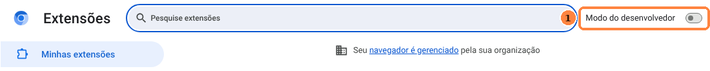
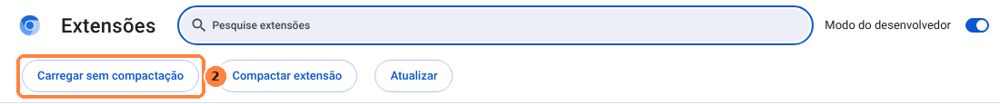
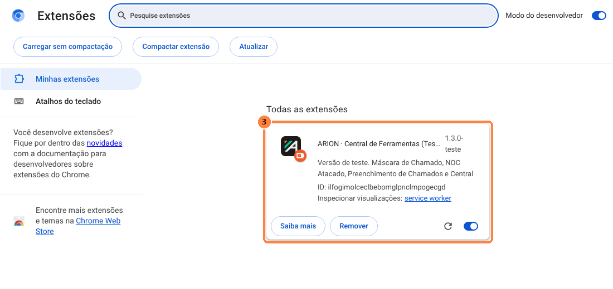
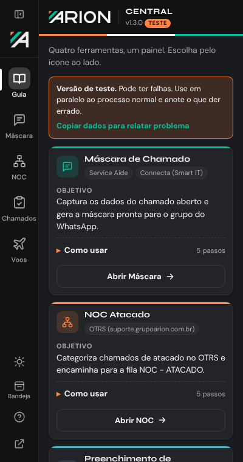
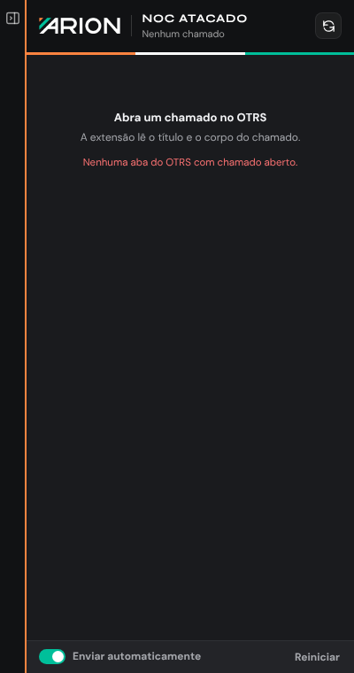
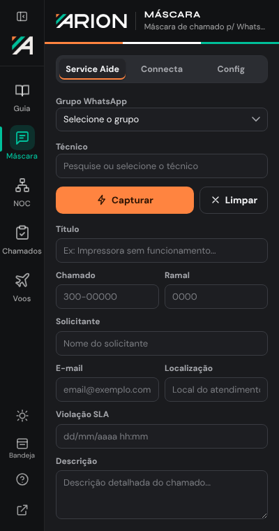
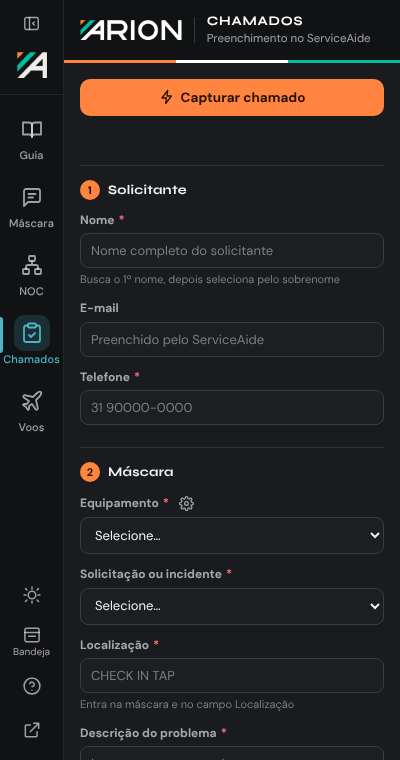
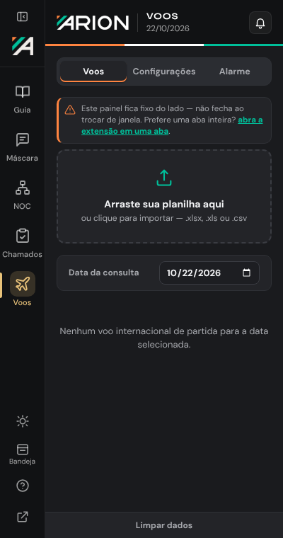
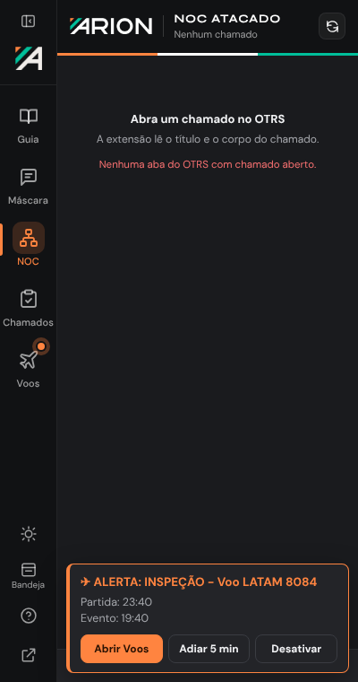
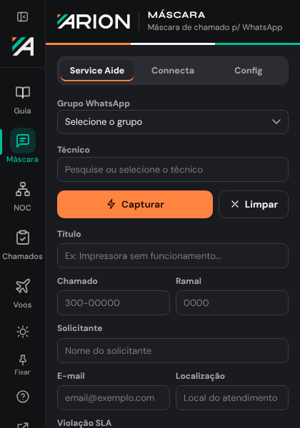

# Guia do usuário — Central de Serviços ARION

> Linguagem: ASD-STE100 (Simplified Technical English), regras adaptadas ao português.
> Frases curtas. Uma ação por passo. Voz ativa. Um termo para cada coisa.

**Versão da extensão:** 1.3.2 (teste)
**Navegadores:** Google Chrome, Microsoft Edge, Mozilla Firefox 128 ou mais recente

---

## Índice

1. [Termos deste guia](#1-termos-deste-guia)
2. [Antes de começar](#2-antes-de-começar)
3. [Instale a extensão no Chrome ou no Edge](#3-instale-a-extensão-no-chrome-ou-no-edge)
4. [Instale a extensão no Firefox](#4-instale-a-extensão-no-firefox)
5. [Abra a Central](#5-abra-a-central)
6. [Use a barra de ícones](#6-use-a-barra-de-ícones)
7. [Use a Máscara de Chamado](#7-use-a-máscara-de-chamado)
8. [Use o NOC Atacado](#8-use-o-noc-atacado)
9. [Use o Preenchimento de Chamados](#9-use-o-preenchimento-de-chamados)
10. [Use a Central de Voos](#10-use-a-central-de-voos)
11. [Mude a forma de exibição](#11-mude-a-forma-de-exibição)
12. [Atualize a extensão](#12-atualize-a-extensão)
13. [Dados e privacidade](#13-dados-e-privacidade)
14. [Resolva problemas](#14-resolva-problemas)
15. [Informe um problema](#15-informe-um-problema)

---

## 1. Termos deste guia

| Termo | Significado |
|---|---|
| **Central** | A extensão completa. |
| **Ferramenta** | Uma das quatro partes da Central: Máscara, NOC, Chamados, Voos. |
| **Barra de ícones** | A coluna escura no lado esquerdo da Central. |
| **Painel lateral** | A área fixa no lado direito do navegador. A Central abre nesta área. |
| **Bandeja** | Uma janela pequena que abre no ícone da extensão. |
| **Guia** | A tela inicial da Central. Mostra o objetivo e os passos de cada ferramenta. |
| **Clique** | Pressione o botão esquerdo do mouse uma vez. |
| **Alarme de voo** | Alarme que a Central faz para a Inspeção ou o Acompanhamento de um voo. |
| **Alarme próprio** | Alarme que você faz: uma tarefa ou um lembrete. |

---

## 2. Antes de começar

1. Faça o download do arquivo `central-servicos-v1.3.2-teste.zip` deste repositório.
2. Clique com o botão direito no arquivo.
3. Clique em **Extrair tudo**.
4. Selecione a pasta `C:\ARION\`.
5. Clique em **Extrair**.

**Resultado:** a pasta `C:\ARION\arion-central` contém o arquivo `manifest.json`.

> **ATENÇÃO:** Não mova nem apague a pasta `C:\ARION\arion-central` depois da instalação.
> O navegador lê a extensão desta pasta. Se a pasta mudar de lugar, a extensão para.

> **NOTA:** Se você tem as extensões antigas (Máscara de Chamado, NOC Atacado,
> Preenchimento de Chamados, Central de Voos), remova-as antes. A Central substitui as quatro.

---

## 3. Instale a extensão no Chrome ou no Edge

### 3.1 Ligue o modo do desenvolvedor

1. Abra o Chrome.
2. Na barra de endereço, digite `chrome://extensions` e pressione **Enter**.
   No Edge, digite `edge://extensions`.
3. Clique no botão **Modo do desenvolvedor** (1).

**Resultado:** uma linha de botões aparece abaixo do título.

### 3.2 Carregue a extensão

1. Clique em **Carregar sem compactação** (2).
   No Edge, o nome do botão é **Carregar sem pacote**.

2. Selecione a pasta `C:\ARION\arion-central`.
3. Clique em **Selecionar pasta**.

**Resultado:** o cartão **ARION · Central de Ferramentas** aparece na lista (3).

### 3.3 Fixe o ícone

1. Clique no ícone de quebra-cabeça, à direita da barra de endereço.
2. Clique no alfinete ao lado de **ARION · Central de Ferramentas**.

**Resultado:** o ícone ARION fica visível na barra do navegador.

> **NOTA:** O Chrome pode mostrar um aviso sobre o modo do desenvolvedor. Este aviso é normal.
> Clique em **Fechar** ou ignore o aviso.

---

## 4. Instale a extensão no Firefox

1. Abra o Firefox.
2. Na barra de endereço, digite `about:debugging#/runtime/this-firefox` e pressione **Enter**.
3. Clique em **Carregar extensão temporária**.
4. Abra a pasta `C:\ARION\arion-central`.
5. Selecione o arquivo `manifest.json`.
6. Clique em **Abrir**.

**Resultado:** a Central aparece na lista de extensões temporárias.

> **ATENÇÃO:** No Firefox, a extensão temporária sai quando você fecha o navegador.
> Faça este procedimento outra vez depois de abrir o Firefox.

> **NOTA:** O Firefox pode pedir permissão para os sites OTRS, ServiceAide e Connecta.
> Abra `about:addons`, clique na Central, clique em **Permissões** e ligue os sites.

---

## 5. Abra a Central

1. Clique no ícone ARION na barra do navegador.

**Resultado:** a Central abre no painel lateral. A primeira tela é o Guia.

> **NOTA:** Atalho do teclado: pressione **Alt + Shift + A**.

O Guia mostra um cartão para cada ferramenta. Cada cartão tem:

- **Objetivo:** o que a ferramenta faz.
- **Como usar:** os passos. Clique no texto para abrir a lista.
- **Abrir:** um botão que abre a ferramenta.

---

## 6. Use a barra de ícones

A barra de ícones fica no lado esquerdo da Central. Use os ícones para trocar de ferramenta.

| Nº | Ícone | Função | Atalho |
|---|---|---|---|
| 1 | Recolher | Diminui a barra para uma faixa fina. Clique outra vez para abrir. | Alt + 0 |
| 2 | Guia | Abre a tela inicial. | Alt + 1 |
| 3 | Máscara | Abre a Máscara de Chamado. | Alt + 2 |
| 4 | NOC | Abre o NOC Atacado. | Alt + 3 |
| 5 | Chamados | Abre o Preenchimento de Chamados. | Alt + 4 |
| 6 | Voos | Abre a Central de Voos. | Alt + 5 |
| 7 | Sol / Lua | Muda o tema para claro ou escuro. | — |
| 8 | Bandeja / Fixar | Muda a forma de exibição. Consulte a seção 11. | — |
| 9 | ? | Mostra os passos da ferramenta aberta. | — |
| 10 | Seta | Abre a Central em uma aba inteira. | — |

> **NOTA:** Quando você troca de ferramenta, os dados preenchidos ficam salvos.

### 6.1 Sinais na barra

| Sinal | Significado |
|---|---|
| Ponto colorido no ícone | A aba aberta é um site desta ferramenta. |
| Ponto laranja que pisca no ícone Voos | Um alarme de voo disparou. |

### 6.2 Recolha a barra

1. Clique no botão **Recolher** (1), no topo da barra.

**Resultado:** a barra fica fina. A ferramenta ocupa mais espaço.

### 6.3 Mude o tema

1. Clique no ícone **Sol** ou **Lua** (7).

**Resultado:** todas as ferramentas mudam de tema ao mesmo tempo.

### 6.4 Veja a ajuda

1. Abra uma ferramenta.
2. Clique no ícone **?** (9).

**Resultado:** os passos da ferramenta aparecem na parte de baixo.

---

## 7. Use a Máscara de Chamado

**Objetivo:** capturar os dados do chamado e fazer a máscara para o WhatsApp.
**Sites:** Service Aide, Connecta (Smart IT).

### 7.1 Configure (uma vez)

1. Clique na aba **Config**.
2. Digite seu nome no campo **Nome do Atendente**.
3. Digite os grupos do WhatsApp. Use uma linha para cada grupo.
4. Clique em **Salvar Configurações**.

### 7.2 Faça a máscara

1. Abra o chamado no Service Aide ou no Connecta.
2. Clique na aba do sistema: **Service Aide** ou **Connecta**.
3. Selecione o grupo do WhatsApp.
4. Selecione o técnico.
5. Clique em **Capturar**.
6. Examine os campos. Corrija os campos com erro.
7. Clique em **Copiar** ou em **WhatsApp**.

**Resultado:** a máscara está na área de transferência. Cole no grupo do WhatsApp.

---

## 8. Use o NOC Atacado

**Objetivo:** categorizar chamados de atacado e encaminhar para a fila NOC - ATACADO.
**Site:** OTRS (suporte.grupoarion.com.br).

1. Abra o chamado no OTRS.
2. Clique no ícone **NOC** na barra de ícones.
3. Se o botão **Permitir acesso ao OTRS** aparecer, clique no botão.
4. Examine os campos Localidade, Operadora, Estado e Designação.
5. Corrija os campos com erro.
6. Clique em **Categorizar**.
7. Clique em **Encaminhar para NOC - ATACADO**.

**Resultado:** o chamado vai para a fila NOC - ATACADO.

> **ATENÇÃO:** A opção **Enviar automaticamente** encaminha o chamado sem a sua revisão.
> Ligue esta opção somente se você conhece bem o processo.

> **NOTA:** Clique em **Reiniciar** para limpar o chamado atual.

---

## 9. Use o Preenchimento de Chamados

**Objetivo:** preencher o formulário do chamado no ServiceAide e fazer o modelo de texto.
**Site:** ServiceAide.

1. Abra o formulário do chamado no ServiceAide.
2. Clique no ícone **Chamados** na barra de ícones.
3. Etapa 1: digite o **Nome** completo do solicitante.
4. Etapa 1: clique em **Localizar**. Consulte a seção 9.1.
5. Etapa 1: digite o **Telefone** do solicitante.
6. Etapa 2: selecione o **Equipamento** e o tipo (**Solicitação** ou **Incidente**).
7. Etapa 2: digite a **Localização** e a **Descrição do problema**.
8. Etapa 3: digite a **Matrícula**, o **Departamento** e a **Identificação do equipamento**.
9. Etapa 4: clique em **Preencher automaticamente**.
10. Examine o formulário no ServiceAide.
11. Clique em **Salvar** no ServiceAide.
12. Clique em **Copiar modelo**.

> **NOTA:** Os campos com * são obrigatórios. Um campo vazio fica com borda vermelha.

> **NOTA:** Para adicionar um equipamento à lista, clique na engrenagem ao lado de **Equipamento**.

### 9.1 Localize o solicitante

**Objetivo:** encontrar o solicitante no ServiceAide antes de preencher.

1. Abra o formulário do chamado no ServiceAide.
2. Digite o **Nome** completo do solicitante.
3. Clique em **Localizar**. Também é possível pressionar `Enter`.

**Resultado:**

| Mensagem | Significado | Ação |
|---|---|---|
| **Encontrado ✓** (verde) | A Central encontrou nome e sobrenome. O nome fica no formulário. O e-mail aparece no campo **E-mail**. | Continue na etapa 1. |
| **Não encontrado** (vermelho) | O ServiceAide não tem o primeiro nome. | Examine o nome. Clique em **Localizar** outra vez. |
| **"Nome" encontrado, mas sobrenome não** (vermelho) | O ServiceAide tem o primeiro nome, mas não o sobrenome. | Examine o sobrenome. Clique em **Localizar** outra vez. |

> **NOTA:** Depois de **Encontrado ✓**, **Preencher automaticamente** não busca o nome outra vez.

> **NOTA:** Se você mudar o nome ou abrir outro chamado, a Central busca o nome outra vez.

> **NOTA:** Se você digita outro e-mail no campo **E-mail**, a Central não muda este e-mail.
> **Preencher automaticamente** escreve o seu e-mail no formulário. A mensagem diz **E-mail mantido**.

### 9.2 Selecione o departamento

1. Clique no campo **Departamento**.
2. Digite parte do nome. Exemplo: `pol`.
3. Clique no departamento na lista.
   Também é possível pressionar a seta para baixo e `Enter`.

> **NOTA:** A lista não diferencia maiúsculas, minúsculas e acentos.

> **NOTA:** Se você digita um departamento que não está na lista, a Central guarda este departamento como sugestão.

---

## 10. Use a Central de Voos

**Objetivo:** ler a planilha de voos, avisar os horários de Inspeção e Acompanhamento (CUPPS)
e preencher os chamados no ServiceAide.

### 10.1 Importe a planilha

1. Clique no ícone **Voos** na barra de ícones.
2. Arraste a planilha para a área **Arraste sua planilha aqui**.
   Também é possível clicar na área e selecionar o arquivo.
3. Selecione a data no campo **Data da consulta**.

**Resultado:** a lista mostra os voos internacionais de partida da data.

> **NOTA:** Arquivos aceitos: `.xlsx`, `.xls`, `.csv`.

### 10.2 Horários

| Evento | Horário |
|---|---|
| Inspeção | 4 horas antes da partida |
| Acompanhamento | 1 hora antes da partida |

### 10.3 Alarmes

O alarme toca antes de cada evento. O alarme funciona com a Central fechada.

- Clique em **Adiar 5 min** para tocar outra vez em 5 minutos.
- Clique em **Desativar** para parar o alarme deste evento.
- Clique no sino, no topo da ferramenta, para silenciar todos os alarmes.
- Clique em **Partida HH:MM ↗** num alarme de voo para abrir o cartão do voo. Consulte a seção 10.5.

### 10.4 Faça um alarme próprio

**Objetivo:** fazer um alarme para uma tarefa de trabalho ou um lembrete. Exemplo: passagem de turno.

1. Clique na aba **Alarme**.
2. Em **Meus alarmes**, clique em **+**.
3. Selecione **Tarefa** ou **Lembrete**.
4. Digite o **Título**.
5. Selecione o **Horário**.
6. Selecione **Repetir**: **Uma vez**, **Diário** ou **Seg a sex**.
7. Se necessário, digite uma **Observação**.
8. Clique em **Criar alarme**.

**Resultado:** o alarme aparece em **Meus alarmes**. A lista mostra os alarmes próprios e os alarmes de voo, por horário.

- Para mudar o alarme, clique em **Editar**.
- Para apagar o alarme, clique em **Excluir**. Clique em **Confirmar exclusão**.
- Para ligar ou desligar o alarme, clique no interruptor.

> **NOTA:** Um alarme **Uma vez** desliga depois de tocar. Para usar outra vez, ligue o interruptor.

> **NOTA:** **Limpar dados** não apaga os alarmes próprios.

### 10.5 Vá para o voo do alarme

1. Clique na aba **Alarme**.
2. Num alarme de voo, clique em **Partida HH:MM ↗**.

**Resultado:** a Central abre a aba **Voos** e mostra o cartão do voo.
O botão para colar pulsa durante 8 segundos:

- Laranja: **Colar Inspeção**.
- Verde: **Colar Acomp.**

### 10.6 Preencha o chamado

1. Abra o formulário "Acompanhamento técnico de voo" no ServiceAide.
2. No cartão do voo, clique em **Colar**.
3. Examine o formulário.
4. Clique em **Salvar** no ServiceAide.
5. Clique em **Copiar informe**.

---

## 11. Mude a forma de exibição

A Central tem duas formas de exibição:

| Forma | Comportamento |
|---|---|
| **Lateral** (padrão) | Fica fixa ao lado da página. Não fecha quando você troca de janela. |
| **Bandeja** | Abre como janela pequena no ícone ARION. Fecha quando você clica fora. |

### 11.1 Mude para bandeja

1. Clique em **Bandeja** (8) na barra de ícones.
2. Clique no ícone ARION na barra do navegador.

**Resultado:** a Central abre como janela pequena.

### 11.2 Mude para lateral

1. Abra a Central na bandeja.
2. Clique em **Fixar** (8).

**Resultado:** a Central abre no painel lateral.

---

## 12. Atualize a extensão

1. Faça o download do arquivo `.zip` novo deste repositório.
2. Extraia o arquivo na mesma pasta: `C:\ARION\`. Substitua os arquivos.
3. Abra `chrome://extensions`.
4. No cartão da Central, clique no ícone de recarregar (seta circular).

**Resultado:** a versão nova está ativa. As suas configurações ficam salvas.

> **ATENÇÃO:** Use sempre a mesma pasta. Se a pasta mudar, as configurações são perdidas.

---

## 13. Dados e privacidade

- A Central não envia dados para a internet.
- Os dados ficam somente no seu navegador.
- A Central apaga os dados de chamados e solicitantes com mais de 7 dias.
- Para apagar agora: abra o Guia e clique em **Limpar agora**.

---

## 14. Resolva problemas

| Problema | Causa provável | Ação |
|---|---|---|
| O ícone ARION não aparece. | O ícone não está fixo. | Faça a seção 3.3. |
| A extensão sumiu do Firefox. | O Firefox apaga extensões temporárias quando fecha. | Faça a seção 4 outra vez. |
| A captura não encontra os campos. | O chamado não está aberto na aba ativa. | Abra o chamado. Clique na aba do chamado. Tente outra vez. |
| O NOC mostra "Nenhuma aba do OTRS". | O OTRS não está aberto. | Abra o chamado no OTRS. Clique no botão de recarregar do NOC. |
| "Sem acesso à aba." | O navegador bloqueou o site. | Abra `chrome://extensions`, clique em **Saiba mais** na Central e permita o site. |
| O alarme não toca. | Os alarmes estão silenciados. | Clique no sino na Central de Voos. |
| **Localizar** mostra "ServiceAide não está aberto". | O formulário do chamado não está aberto. | Abra o formulário no ServiceAide. Clique em **Localizar** outra vez. |
| **Partida HH:MM ↗** mostra "Voo não encontrado". | A data da consulta é diferente da data do voo. | Selecione a data do voo em **Data da consulta**. |
| A Central mostra erro depois de atualizar. | O navegador usa a versão antiga. | Clique no ícone de recarregar em `chrome://extensions`. |

---

## 15. Informe um problema

1. Abra o Guia.
2. Clique em **Copiar dados para relatar problema**.
3. Cole o texto numa mensagem.
4. Escreva o que aconteceu e o que você esperava.
5. Envie a mensagem para o responsável pela Central.
