# Central de Serviços ARION — Branch `alpha` (experimental)

> **Versão experimental 2.0.0-alpha.9.** Visual minimalista, mesmas funções da 1.3.3.
> Instala ao lado da versão normal (é outra extensão). A versão estável continua na branch `main`.

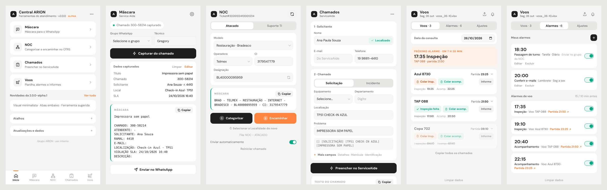

| | |
|---|---|
| **Versão** | 2.0.0-alpha.9 |
| **Download** | [`arion-central-2.0.0-alpha.9.zip`](arion-central-2.0.0-alpha.9.zip) |
| **Arquivo de versão** | [`versao.json`](versao.json) |

### Trocar tema

Início → ⋯ → **Trocar tema**. Passe o mouse num tema para ver a Central inteira com ele. Clique para usar.

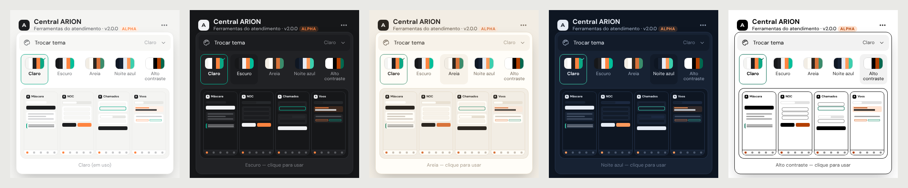

### Instale

1. Faça o download de `arion-central-2.0.0-alpha.9.zip`.
2. Extraia em `C:\ARION\`.
3. Abra `chrome://extensions`. Ligue **Modo do desenvolvedor**.
4. Clique em **Carregar sem compactação**. Selecione `C:\ARION\arion-central-alpha`.

### Firefox: libere o acesso aos sites

No Firefox, o acesso ao OTRS e ao ServiceAide não vem ligado na instalação.

1. Abra a Central. No Início, clique em **Permitir acesso**.
2. Clique em **Permitir** na janela do Firefox.

**Resultado:** NOC, Chamados e Voos leem o OTRS e o ServiceAide.

### Aviso de versão nova

A Central lê o [`versao.json`](versao.json) desta branch a cada 6 horas e ao abrir o navegador.

Se a versão do arquivo é maior que a instalada:

- o ícone ARION mostra o selo **1**;
- aparece uma notificação. Clique nela para baixar;
- o Início mostra o aviso com o botão **Baixar**.

Para atualizar: extraia o zip novo na mesma pasta. Clique em recarregar em `chrome://extensions`.

> **NOTA:** A extensão não se troca sozinha. O Chrome não permite isso no modo "Carregar sem compactação".

### Publique uma versão nova (responsável)

1. Mude `version` e `version_name` no `manifest.json`.
2. Gere o zip e envie para esta branch.
3. Mude `versao`, `nome`, `download` e `notas` no `versao.json`. Envie.

**Resultado:** em até 6 horas, todos recebem o aviso.

---

# Central de Serviços ARION

**Uma extensão. Quatro ferramentas. Navegação por ícones.**
Extensão de navegador para o atendimento do Grupo ARION (uso interno).

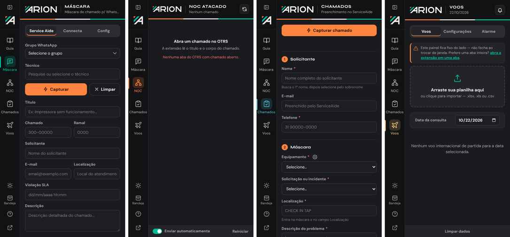

| | |
|---|---|
| **Versão** | 1.3.3 (teste) |
| **Navegadores** | Google Chrome, Microsoft Edge, Mozilla Firefox 128+ |
| **Download** | [`central-servicos-v1.3.3-teste.zip`](central-servicos-v1.3.3-teste.zip) |
| **Manual do usuário** | [GUIA-DO-USUARIO.md](GUIA-DO-USUARIO.md) (linguagem ASD-STE100) |

---

## O que é

A Central junta quatro extensões antigas em uma só. Cada ferramenta tem um ícone na barra lateral.

| Ícone | Ferramenta | Objetivo | Sites |
|---|---|---|---|
| 💬 | **Máscara de Chamado** | Captura o chamado e gera a máscara para o WhatsApp. | Service Aide |
| 🖧 | **NOC** | Categoriza chamados de Atacado e de Suporte TI (Engenharia). Encaminha para NOC - ATACADO ou ENG - SISTEMAS. | OTRS |
| 📋 | **Preenchimento de Chamados** | Preenche o formulário do chamado e gera o modelo de texto. | ServiceAide |
| ✈️ | **Central de Voos** | Lê a planilha de voos, avisa Inspeção e Acompanhamento (CUPPS) e preenche os chamados. | ServiceAide |

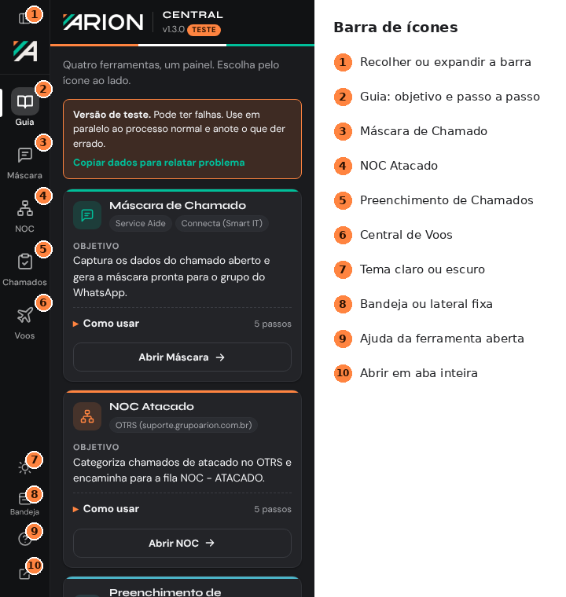

---

## Instalação rápida

1. Faça o download de [`central-servicos-v1.3.3-teste.zip`](central-servicos-v1.3.3-teste.zip).
2. Extraia em `C:\ARION\`.
3. Abra `chrome://extensions` (Edge: `edge://extensions`).
4. Ligue **Modo do desenvolvedor**.
5. Clique em **Carregar sem compactação** e selecione `C:\ARION\arion-central`.

Passo a passo com imagens, Firefox e uso de cada ferramenta: **[Guia do usuário](GUIA-DO-USUARIO.md)**.

---

## Recursos

- **Barra de ícones** com as 4 ferramentas, recolhível (`Alt+0`).
- **Guia** com objetivo e passo a passo de cada ferramenta, mais ajuda contextual (`?`).
- **Site detectado:** a Central indica a ferramenta certa para a aba aberta.
- **Painel lateral fixo ou bandeja**, à escolha do usuário.
- **Tema claro e escuro** único para todas as ferramentas.
- **Alarmes de voo** com notificação, som, adiar e silenciar — funcionam com a Central fechada.
- **Meus alarmes:** o botão **+** cria tarefas e lembretes (ex.: passagem de turno). Repetição: uma vez, diário ou segunda a sexta. Lista separada dos alarmes de voo.
- **10 sons de alarme** com nomes simples (ex.: Clássico, Sino, Avião decolando).
- **NOC com tipo de chamado:** NOC Atacado ou Suporte TI (Engenharia). Máscaras de Restauração, Reincidência e Cancelamento.
- **Campos de seleção com filtro:** digite parte do texto. A lista mostra só as opções que combinam.
- **Ir para o voo:** o link **Partida HH:MM ↗** abre o cartão do voo. Um pulso mostra o botão de colar correto.
- **Localizar solicitante:** o botão **Localizar** procura nome e sobrenome no ServiceAide. A Central não repete a busca no preenchimento.
- **E-mail protegido:** se você digita outro e-mail, a Central não muda o e-mail.
- **Departamento com sugestões:** digite parte do nome. A lista mostra os departamentos do ServiceAide.
- **Atalhos:** `Alt+Shift+A` abre; `Alt+1…5` troca de ferramenta.
- **Visual padronizado:** mesmo cabeçalho, cores, fontes, botões e campos nas 4 ferramentas.

<p>
  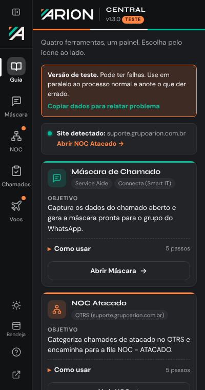
  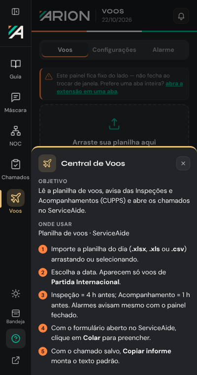
  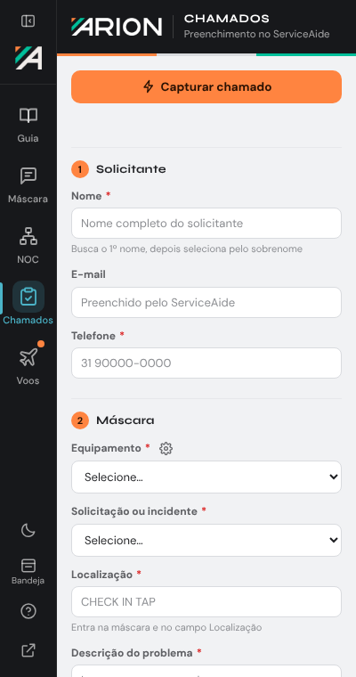
</p>

### Novo na versão 1.3.3

**Tipo de chamado (NOC)**

1. Abra o chamado no OTRS.
2. Clique no ícone **NOC**.
3. Em **Tipo de chamado**, selecione **NOC Atacado** ou **Suporte TI (Engenharia)**.

**Resultado:** a Central mostra os campos e a máscara do tipo selecionado.

<p>
  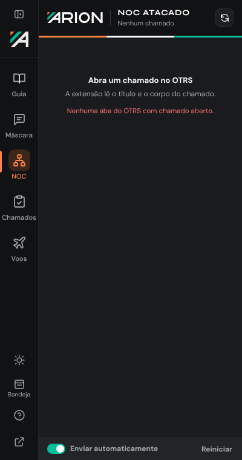
  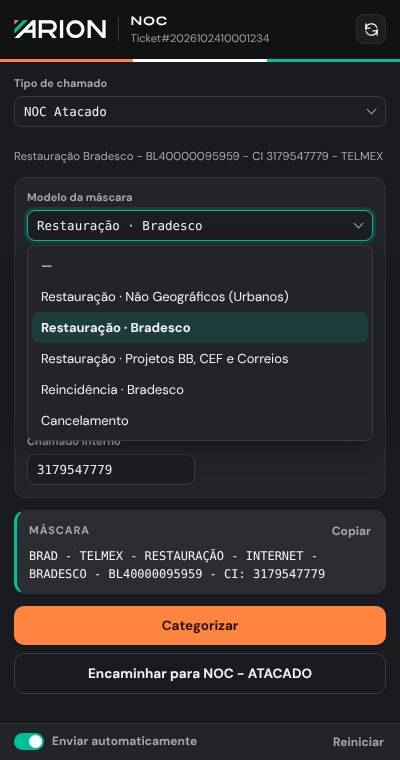
  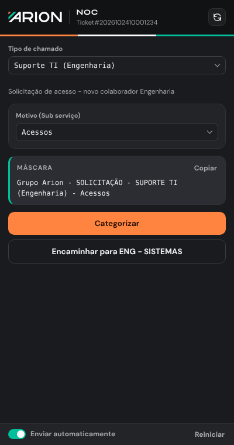
</p>

**NOC Atacado — modelos de máscara**

| Modelo | Exemplo de máscara | Identificador |
|---|---|---|
| Restauração · Não Geográficos (Urbanos) | `Não Geográficos (Urbanos) - CLARO S.A. - RESTAURAÇÃO - INTERNET - PROJETO CARREFOUR - BL300000097058 - CI: 473084` | CI (McDonald's: SIGLA) |
| Restauração · Bradesco | `BRAD - TELEFONICA BRASIL S.A. - RESTAURAÇÃO - INTERNET - BRADESCO - BD0001222 - BRAD: 791` | BRAD (Vivo) / CI (Telmex) |
| Restauração · Projetos BB, CEF e Correios | `Projeto BB - CLARO S.A. - RESTAURAÇÃO - INTERNET - PROJETO BB - … - CI: …` | CI |
| Reincidência · Bradesco | `[REINCIDENCIA MONITORAMENTO] - TELMEX - BRADESCO - BD500000098988 - BRAD:2950` | BRAD |
| Cancelamento | `NGO - TELEFONICA BRASIL S.A. - CANCELAMENTO - INTERNET - OP:AN TELECOM - BD0001246 - NP:15576` | NP |

- Para **Não Geográficos (Urbanos)** e **Projetos**, selecione também o **Cliente**.
- **Reincidência** e **Cancelamento** só fazem a máscara. Clique em **Copiar**.

**Suporte TI (Engenharia)**

1. Selecione o **Motivo**: Notebook, Celular, Acessos, E-mails, Softwares ou Outras.
2. Clique em **Categorizar**.
3. Clique em **Encaminhar para ENG - SISTEMAS**.

**Resultado:** assunto `Grupo Arion - SOLICITAÇÃO - SUPORTE TI (Engenharia) - <Motivo>`. Tipo Solicitação, SLA Sem SLA, Site NGO - NAO GEOGRAFICO, Empresa Grupo Arion. A nota de encaminhamento vai para a equipe Eng. Sistemas.

**Meus alarmes e Alarmes de voo (Central de Voos → Alarme)**

- Os alarmes próprios ficam em **Meus alarmes**. Os alarmes de voo ficam em **Alarmes de voo**.
- Um alarme adiado (**Adiar 5 min**) mostra **Agendado**.

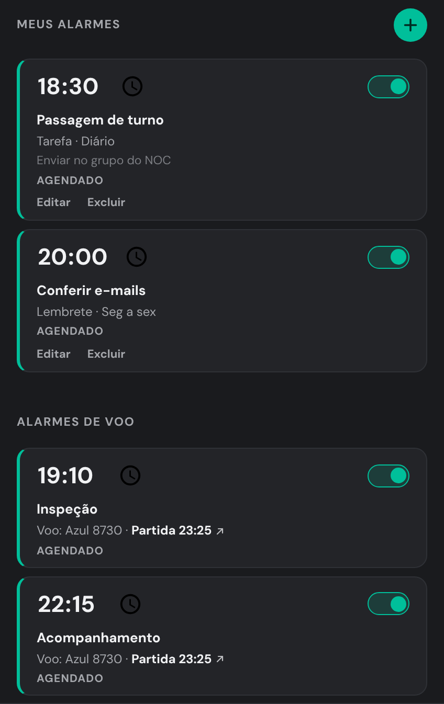

**Som do alarme**

1. Clique na aba **Alarme**.
2. Em **Som do alarme**, selecione um som. A Central toca o som durante 3 segundos.

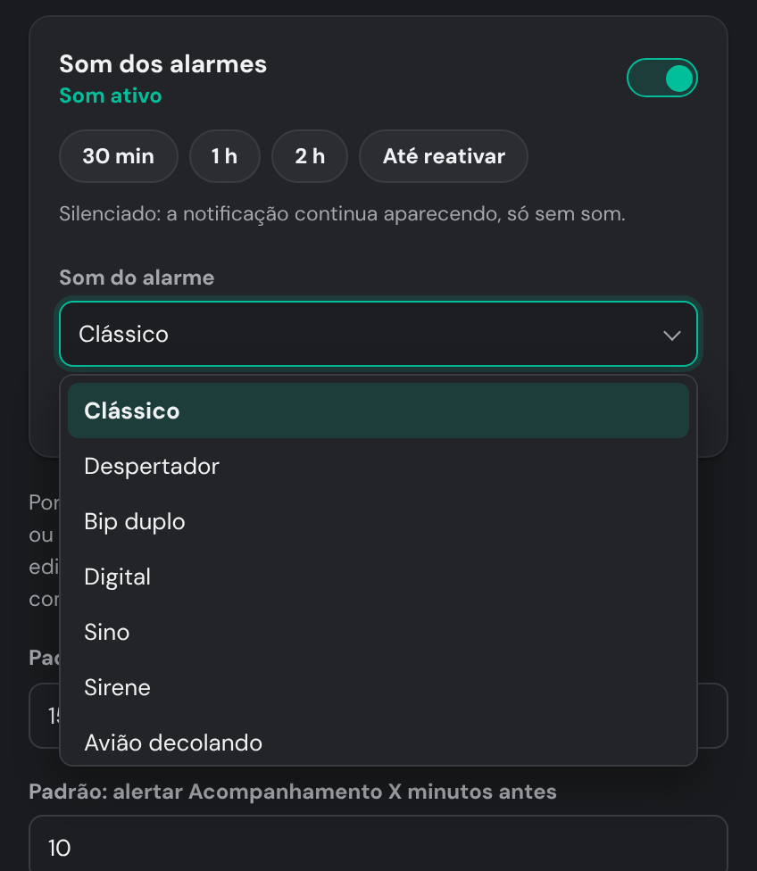

**Máscara de Chamado**

- O Connecta (Smart IT) foi removido. A Máscara funciona só no Service Aide.
- O campo **Técnico** não mostra mais a lista de nomes. Digite o nome.

### Novo na versão 1.3.2

**Departamento (Preenchimento de Chamados)**

1. Clique no campo **Departamento**.
2. Digite parte do nome. Exemplo: `pol`.
3. Clique no departamento. Também é possível usar as setas e `Enter`.

**Resultado:** o campo recebe o nome correto do departamento.

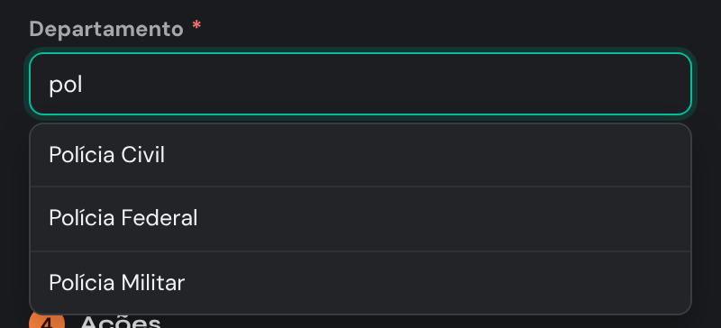

**E-mail**

Se você digita um e-mail depois de **Localizar**, a Central não muda este e-mail.
**Preencher automaticamente** escreve o seu e-mail no formulário. A mensagem diz **E-mail mantido**.

### Novo na versão 1.3.1

**Meus alarmes (Central de Voos → Alarme)**

1. Clique em **+**.
2. Selecione **Tarefa** ou **Lembrete**.
3. Digite o **Título** e o **Horário**.
4. Selecione **Repetir**.
5. Clique em **Criar alarme**.

**Resultado:** o alarme aparece em **Meus alarmes**, com os alarmes de voo.

**Partida HH:MM ↗**

1. Clique em **Partida HH:MM ↗** num alarme de voo.

**Resultado:** a Central abre o cartão do voo. O botão para colar pulsa durante 8 segundos.
Laranja = Inspeção. Verde = Acompanhamento.

**Localizar (Preenchimento de Chamados)**

1. Digite o **Nome** completo do solicitante.
2. Clique em **Localizar** (ou pressione `Enter`).

**Resultado:** a Central mostra **Encontrado** ou **Não encontrado**.
Se encontrou, o nome fica no formulário e o e-mail é preenchido.
**Preencher automaticamente** não busca o nome outra vez.

<p>
  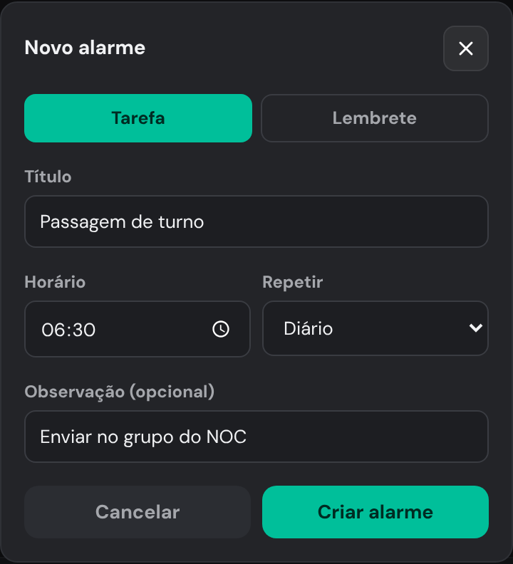
  
</p>
<p>
  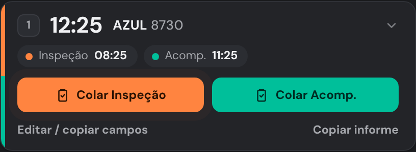
  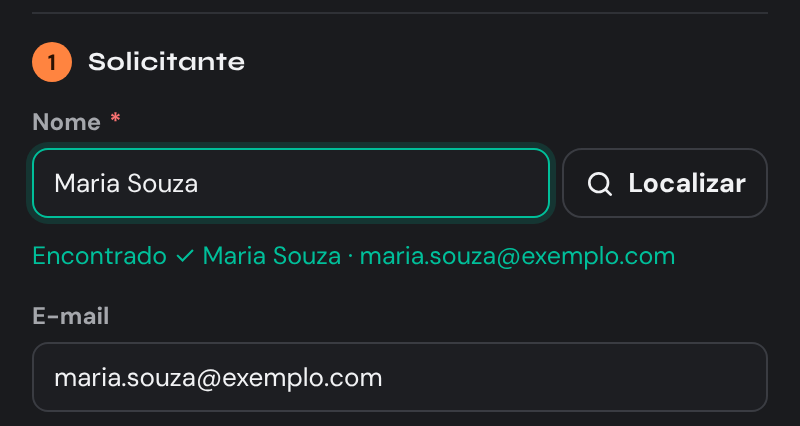
</p>

---

## Privacidade e segurança

- Nenhum dado sai do navegador. Sem servidores, sem telemetria.
- Fontes e bibliotecas ficam dentro da extensão (não usa CDN nem Google Fonts).
- Dados de chamados e solicitantes são apagados após **7 dias** (inclui o nome localizado).
- Textos vindos de páginas e planilhas são tratados antes de aparecer na tela.
- Biblioteca de planilhas: SheetJS 0.20.3.

---

## Estrutura do pacote

```
arion-central/
├── manifest.json        Manifest V3 único (Chrome, Edge, Firefox)
├── background.js        Painel lateral, alarmes, limpeza de dados
├── hub/                 Barra de ícones, Guia, ajuda, avisos
├── shared/              Design system: cores, tema, fontes, logo, campo de seleção com filtro
├── sounds/              Sons dos alarmes (lista em sons.js)
└── apps/
    ├── mascara/         Máscara de Chamado
    ├── noc-atacado/     NOC (Atacado e Suporte TI)
    ├── preenchimento/   Preenchimento de Chamados
    └── voos/            Central de Voos
```

**Tecnologias:** WebExtensions Manifest V3 · JavaScript puro (sem build) · HTML5 e CSS3 · SheetJS · DM Sans e Syne (OFL).

---

## Versões

| Versão | Mudanças |
|---|---|
| **1.3.3 (teste)** | NOC: tipo de chamado (Atacado ou Suporte TI), máscaras novas, cliente para Não Geográficos; Meus alarmes e Alarmes de voo separados; adiado = Agendado; 10 sons; Connecta removido; filtro nos campos de seleção. |
| 1.3.2 (teste) | E-mail digitado não é sobrescrito; Departamento com sugestões (41 opções do ServiceAide). |
| 1.3.1 (teste) | Meus alarmes (tarefas e lembretes, botão +); link **Partida** com destaque no botão de colar; botão **Localizar** no Nome do Preenchimento. |
| 1.3.0 (teste) | Visual padronizado; tema único; fontes locais; correções de segurança; SheetJS 0.20.3; limpeza de dados após 7 dias; aviso de versão nova. |
| 1.2.0 | Botão para recolher a barra. |
| 1.1.0 | Modo bandeja ou lateral fixa. |
| 1.0.0 | Primeira versão: 4 extensões em uma. |

---

## Problemas

Na Central, abra o **Guia** → **Copiar dados para relatar problema** e envie o texto para o responsável,
ou abra uma *issue* neste repositório.

*Grupo ARION · uso interno*
