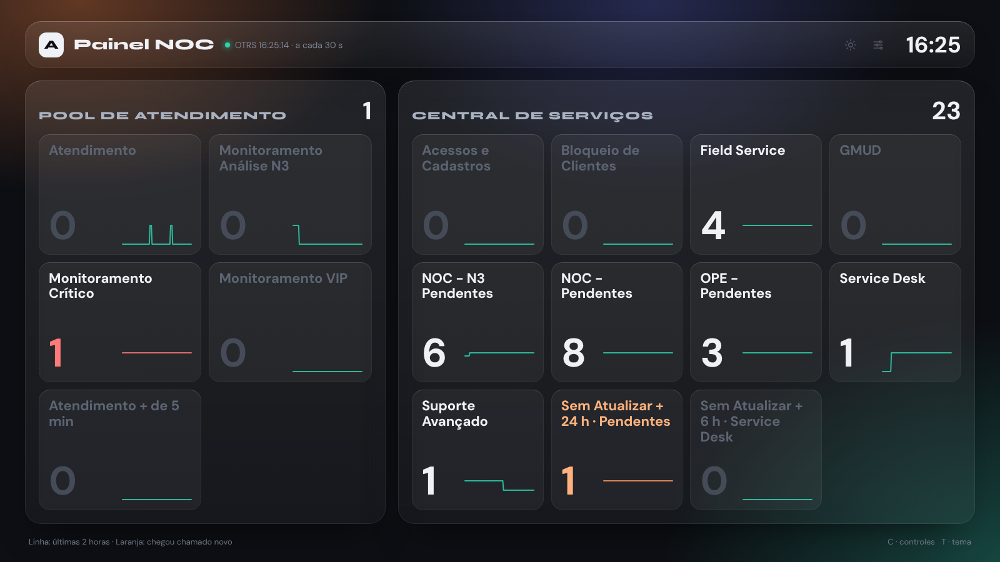

# Central de Serviços ARION

> **Versão 2.0.0-alpha.24.** Extensão do atendimento ARION: Copiar Chamado, Categorização (OTRS), Abertura de Chamados, Inspeção de Voos, Painel NOC e Passagem de turno.
> Substitui a versão 1.3.3. Ainda é **alpha**: teste e relate problemas pelo menu ⋯ → **Relatar problema**.


| | |
|---|---|
| **Versão** | 2.0.0-alpha.24 |
| **Navegadores** | Google Chrome, Microsoft Edge, Mozilla Firefox 128+ |
| **Download** | [`arion-central-2.0.0-alpha.24.zip`](arion-central-2.0.0-alpha.24.zip) |
| **Arquivo de versão** | [`versao.json`](versao.json) |

## Manuais (passo a passo)

Um manual para cada tela, com prints, em linguagem ASD-STE100: [`manuais/`](manuais/00-LEIA-PRIMEIRO.md). Cada seção de **Como usar** abaixo tem o link do seu manual.

| Tela | Manual |
|---|---|
| Início, barra rápida e menu ⋯ | [01-inicio.md](manuais/01-inicio.md) |
| Copiar Chamado | [02-copiar-chamado.md](manuais/02-copiar-chamado.md) |
| Categorização | [03-categorizacao.md](manuais/03-categorizacao.md) |
| Abertura de Chamados | [04-abertura-de-chamados.md](manuais/04-abertura-de-chamados.md) |
| Inspeção de Voos | [05-inspecao-de-voos.md](manuais/05-inspecao-de-voos.md) |
| Painel NOC | [06-painel-noc.md](manuais/06-painel-noc.md) |
| Tela de avisos (Canva) | [07-tela-de-avisos.md](manuais/07-tela-de-avisos.md) |
| Passagem de turno | [08-passagem-de-turno.md](manuais/08-passagem-de-turno.md) |

## Ferramentas

| Aba | Ferramenta | O que faz | Site |
|---|---|---|---|
| Copiar | **Copiar Chamado** | Captura o chamado e gera a máscara. A máscara é editável. | ServiceAide |
| Categorizar | **Categorização** | Categoriza e encaminha: NOC - ATACADO, ENG - SISTEMAS, NOC - CANCELAMENTOS NGO ou NOC - ACESSOS E CADASTROS. Aba **Encaminhar**: qualquer fila. | OTRS |
| Abrir | **Abertura de Chamados** | Preenche o formulário do chamado e gera o texto do chamado. | ServiceAide |
| Voos | **Inspeção de Voos** | Lê a planilha, toca os alarmes de Inspeção e Acompanhamento e preenche os chamados. | ServiceAide |
| ⋯ | **Painel NOC** | Pool e Central de Serviços na TV e Tela de avisos (Canva) na TV do meio. | OTRS · Canva |
| ⋯ | **Passagem de turno** | Texto da passagem de turno para o WhatsApp. | OTRS |

### Barra rápida

> 📘 **Passo a passo com prints:** [01 · Início, barra rápida e menu ⋯](manuais/01-inicio.md)

Pílula de vidro no rodapé: **Início | Copiar · Abrir · Voos | Categorizar**.

- A aba aberta mostra o nome. As outras mostram o nome ao passar o mouse.
- Ponto verde: ferramenta do site aberto na aba.
- `Alt+1` a `Alt+5` troca de aba. `Alt+Shift+A` abre a Central.

### Menu ⋯ (Início)

**Painel NOC**, **Passagem de turno**, Como usar, Relatar problema, Verificar atualização, Limpar dados antigos e **Trocar tema** (último item).

## Instale

> **Quem usa a 1.3.3:** a 2.0 é outra extensão. Instale a 2.0, confira e depois remova a 1.3.3. Os cadastros da 1.3.3 não passam para a 2.0 (veja [Levar equipamentos e localizações](#levar-equipamentos-e-localizações)).

1. Faça o download de `arion-central-2.0.0-alpha.24.zip`.
2. Extraia em `C:\ARION\`.
3. Abra `chrome://extensions` (Edge: `edge://extensions`). Ligue **Modo do desenvolvedor**.
4. Clique em **Carregar sem compactação**. Selecione `C:\ARION\arion-central-alpha`.

### Firefox: libere o acesso aos sites

No Firefox, o acesso ao OTRS e ao ServiceAide não vem ligado na instalação.

1. Abra a Central. No Início, clique em **Permitir acesso**.
2. Clique em **Permitir** na janela do Firefox.

**Resultado:** Categorização, Abertura de Chamados e Inspeção de Voos leem o OTRS e o ServiceAide.

## Como usar

### Copiar Chamado

> 📘 **Passo a passo com prints:** [02 · Copiar Chamado](manuais/02-copiar-chamado.md)

1. Primeira vez: clique na engrenagem (abre uma janela). Digite seu nome de atendente. Clique em **Salvar**.
2. Abra o chamado no ServiceAide.
3. Clique em **Capturar chamado**.
4. Confira a máscara. Clique no texto para editar.
5. Clique em **Copiar**. As edições vão junto. **Limpar** apaga a máscara.

### Categorização (OTRS)

> 📘 **Passo a passo com prints:** [03 · Categorização](manuais/03-categorizacao.md)

1. Abra o chamado no OTRS.
2. Escolha **Atacado**, **Suporte TI** ou **Comercial**.
3. Confira os dados. Clique em **Categorizar**.
4. Clique em **Encaminhar**. Depois, clique em **Mover para a fila** e confirme.

**Modelos (Atacado)**

| Modelo | Exemplo de máscara |
|---|---|
| Restauração · Não Geográficos (Urbanos) | `Não Geográficos (Urbanos) - CLARO S.A. - RESTAURAÇÃO - INTERNET - PROJETO CARREFOUR - BL300000097058 - CI: 473084` |
| Restauração · Bradesco | `BRAD - TELEFONICA BRASIL S.A. - RESTAURAÇÃO - INTERNET - BRADESCO - BD0001222 - BRAD: 791` |
| Restauração · Projetos BB, CEF, Correios e FUST | `Projeto FUST - TELEFONICA BRASIL S.A. - RESTAURAÇÃO - INTERNET - PROJETO FUST - VIVO.BA.BLIVR000093 - INC10412506` |
| Restauração · Projeto Algar | `Projeto EILD Algar - SP - RESTAURAÇÃO - INTERNET - PROJETO ALGAR - BL100000104483 - CI: 473084` (sem a operadora) |
| Reincidência · Bradesco | `[REINCIDENCIA MONITORAMENTO] - TELMEX - BRADESCO - BD500000098988 - BRAD:2950` |
| Cancelamento | `NGO - TELEFONICA BRASIL S.A. - CANCELAMENTO - INTERNET - OP:AN TELECOM - BD0001246 - NP:15576` |
| **Cancelar Serviços · NGO** | `Não Geográficos (Urbanos) - LAVEZZO CORPORACOES COMERCIAIS LTDA - CANCELAMENTO - INTERNET - Pedido: 16003` |
| Restauração · Arcos Dourados - CNF | Igual ao Arcos Dourados. No Encaminhar, escolha **OPE - FIELD SERVICES** ou **NOC - SUPORTE AVANÇADO**. |
| Solicitação de Tratativa de Qualidade | Título e Assunto = o título que veio. Fila **NOC - QUALIDADE ATACADO**. |
| **Solicitação · Cadastro no CMDB** | `Não Geográficos (Urbanos) - NORTH TELECOM - SOLICITAÇÃO - INTERNET - CADASTRO NO CMDB` |

- **Reincidência** e **Cancelamento** só fazem a máscara. Clique em **Copiar**.
- **FUST:** Localidade **Projeto FUST**. Identificador INC da Vivo.

**Cancelar Serviços · NGO**

Chamado do SGF com o título `Cancelar Serviços do Pedido: N` (fila ATENDIMENTO).

1. A Central lê do pedido: Razão social, Nome fantasia, Telefone, CNPJ, Contato, E-mail e produtos.
2. **POP** (GRU, GIG, BSB, CNF, VCP, FLN, MEA, VIX, POA, FOR, Congonhas, Curitiba, Cuiabá, NAT): a Central avisa e não categoriza. POP não tem este processo.
3. Fora dos POP, **Categorizar** preenche:
   - Localidade **Não Geográficos (Urbanos)**;
   - Razão social, Nome fantasia e Telefone;
   - Enviar N1 = **Sim**;
   - Título e Assunto = a máscara;
   - Texto: *Arion - Central de Atendimento · Este ticket foi categorizado e encaminhado para a fila Service Desk.*
4. **Encaminhar** faz a nota (Abertura chamado ISP = **Não**) e move para **NOC - CANCELAMENTOS NGO**.

> **NOTA:** o campo **Local** corrige o POP à mão. Tipo (Cancelamento) e SLA (primeira opção) ainda estão em definição.

**Solicitação · Cadastro no CMDB**

Chamado com a palavra `CMDB` no título ou no corpo.

1. Localidade: **Não Geográficos (Urbanos)**. Com a palavra "aeroporto": **Não Geográficos (Aeroportos)**.
2. **Empresa:** a Central procura `Empresa:`, `Razão Social:` ou `Nome Fantasia:` no chamado. Se não achar, digite no painel.
3. **Categorizar** preenche:
   - Tipo **Solicitação**;
   - Razão social e Nome fantasia com a empresa;
   - Serviço SGF **Internet** e Serviço **Internet**;
   - SLA **24 Horas 24x7** e Site **NGO - NAO GEOGRAFICO**;
   - Título e Assunto = a máscara;
   - Texto: *Arion - Central de Atendimento · Este ticket foi categorizado e encaminhado para a fila Service Desk.*
4. **Encaminhar** faz a nota (Abertura chamado ISP = **Não**) e move para **NOC - ACESSOS E CADASTROS**.

> **NOTA:** a empresa precisa existir na lista do OTRS. Se não existir, a Central avisa: Razão social não preenchida.

**Arcos Dourados em Confins (CNF)**

A Central escolhe sempre **Arcos Dourados**. Se o chamado for de Confins, troque o cliente para **Arcos Dourados - CNF** (cliente POP).

1. Categorizar: igual ao Arcos Dourados.
2. Escolha a **Fila do Encaminhar**: OPE - FIELD SERVICES ou NOC - SUPORTE AVANÇADO.
3. Encaminhar: nota com a fila escolhida e move para ela.

**Solicitação de Tratativa de Qualidade**

Título `SOLICITAÇÃO DE TRATATIVA DE QUALIDADE | OQ-… | TQ-… | Cliente | Operadora | Designação`.

1. A Central lê cliente, operadora e designação do título e categoriza normalmente.
2. Título e Assunto ficam com o título que veio.
3. Encaminhar: nota e fila **NOC - QUALIDADE ATACADO**.

**Histórico (lupa)**

> 📘 **Passo a passo com prints:** [03 · Categorização › Histórico](manuais/03-categorizacao.md#6-hist%C3%B3rico-lupa)

1. Clique na lupa no topo da Categorização (ao lado do ↻).
2. Digite a designação, o nº do chamado, a operadora ou uma palavra.
3. Em **Onde**, escolha **Chamados antigos**, **Link de internet** ou **Operadora**. Tecle **Enter**.
4. Clique no ícone de copiar ao lado do campo.

- Só leitura. Chamados: 30 dias, depois 12 meses; **Histórico completo** sob demanda (~15 s).
- Cache local: chamados 30 min, links e operadoras 24 h. **Limpar cache** apaga. Senha e PPPoE nunca aparecem.

**Encaminhar (qualquer fila)**

> 📘 **Passo a passo com prints:** [03 · Categorização › Encaminhar](manuais/03-categorizacao.md#5-aba-encaminhar-qualquer-fila)

1. Abra o chamado no OTRS (tela de detalhes). Clique na aba **Encaminhar**.
2. Em **Fila**, digite parte do nome e escolha (as 38 filas do OTRS; hífen e travessão contam como iguais). **Atualizar filas** lê a lista de novo no chamado.
3. Confira a **Nota de encaminhamento** (editável).
4. Clique em **Encaminhar** e confirme: a Central envia a nota.
5. Clique em **Mover para …** e confirme: o chamado vai para a fila. Não tem desfazer.

**Comercial (teste)**

> 📘 **Passo a passo com prints:** [03 · Categorização › Comercial](manuais/03-categorizacao.md#4-aba-comercial-teste)

1. Abra o chamado no OTRS. Clique em **Capturar chamado**.
   - Chamado: número do ticket.
   - Nome do cliente, Empresa, Contato, E-mail e Descrição: a Central procura no chamado e mostra de onde veio. Não achou: digite.
   - **Localidade:** começa vazia. Digite e escolha uma das 137 localidades do OTRS.
2. Clique em **Abrir chamado** (fica fixo no rodapé). A Central:
   - grava **Data e Hora** do clique;
   - abre "Novo chamado de Restauração/Solicitação" e preenche os campos. Confira e clique em **Enviar**.
3. No card **Planilha CSTI**, copie cada campo pelo ícone de copiar (CHAMADO, NOME DO CLIENTE, EMPRESA, DATA, HORA) e cole na planilha.
   - **Copiar linha**: as 5 colunas de uma vez, para colar na coluna A da linha vazia.

> **NOTA:** os valores do chamado novo (Tipo, Serviço SGF, Serviço, SLA, Site e Assunto) ficam em **Campos do chamado novo (OTRS)**.

### Abertura de Chamados

> 📘 **Passo a passo com prints:** [04 · Abertura de Chamados](manuais/04-abertura-de-chamados.md)

1. Abra o formulário do chamado no ServiceAide.
2. **1 · Solicitante:** digite o nome e clique em **Localizar**. O Telefone é opcional.
3. **2 · Chamado:** Solicitação ou Incidente, Equipamento, Departamento, Localização e Problema.
4. Clique em **Preencher no ServiceAide**. Confira e salve.
5. **Copiar** captura o chamado e copia o texto no modelo da máscara.

A **engrenagem** ao lado de **Equipamento** abre a lista de equipamentos: Adicionar e remover (✕).

### Inspeção de Voos

> 📘 **Passo a passo com prints:** [05 · Inspeção de Voos](manuais/05-inspecao-de-voos.md)

1. Importe a planilha do dia (`.xlsx`, `.xls` ou `.csv`).
2. Escolha a data. Aparecem só os voos de **Partida Internacional**.
3. Os alarmes tocam 4 h antes (Inspeção) e 1 h antes (Acompanhamento), mesmo com a Central fechada.
4. Com o formulário aberto no ServiceAide, clique em **Colar**.

### Painel NOC (Início → ⋯ → Painel NOC)

> 📘 **Passo a passo com prints:** [06 · Painel NOC](manuais/06-painel-noc.md)

**Na TV (só no PC da TV)**

1. Entre no OTRS nesse Chrome.
2. Clique em **Abrir na TV**. A Central abre o Painel das Filas do OTRS numa aba fixada e recarrega a cada 30 s.
3. Aperte **F** para tela cheia. **T** troca o tema (escuro/claro). **C** abre os controles (intervalo, linha de tendência).

- Cada caixa mostra o nome da fila, o número e a linha das últimas 2 horas.
- Chamado novo no Pool: caixa em laranja com "chegou HH:MM" (10 min), sem som.
- OTRS parado ou deslogado: faixa vermelha "OTRS sem atualizar desde HH:MM".



**Tela de avisos (Canva) — TV do meio**

> 📘 **Passo a passo com prints:** [07 · Tela de avisos (Canva)](manuais/07-tela-de-avisos.md)

1. Clique em **Tela de avisos (Canva)**. Abre numa janela: leve para a TV do meio e aperte **F**.
2. Aperte **C** e cole o link de incorporação do Canva (Compartilhar → Mais → Incorporar). O design precisa estar com "qualquer pessoa com o link pode ver".
3. Escolha o **tempo por slide** (10, 20, 30 ou 60 s) e quando **recarregar** (a cada volta, 5, 15 ou 30 min).

- A Central passa os slides sozinha. O próximo slide carrega por trás e entra com fade.
- Faixa no rodapé com o Pool e a Central (pode ocultar). Setas ← → trocam o slide.
- A Central só lê o Canva. Não altera nada no design.

> **NOTA:** não entre no Canva pelo Chrome do PC das TVs. Com o Canva logado, ele recusa abrir dentro da Central ("a conexão foi recusada"). Para editar os avisos, use outro PC ou outro perfil do Chrome.

### Passagem de turno (Início → ⋯ → Passagem de turno)

> 📘 **Passo a passo com prints:** [08 · Passagem de turno](manuais/08-passagem-de-turno.md)

1. Escolha o analista (**Analistas** cadastra e remove, numa janela).
2. **Ler agora** traz os números das 16 localidades (grupo PASSAGEM DE TURNO do OTRS).
3. Adicione os chamados (Ticket# e título). Marque **Continuidade** e **Crítico** e escreva o status.
4. **Copiar para o WhatsApp.** Os chamados ficam para a próxima passagem. Remova os fechados no ✕.

### Trocar tema

> 📘 **Passo a passo com prints:** [01 · Início › Troque o tema](manuais/01-inicio.md#5-troque-o-tema)

Início → ⋯ → **Trocar tema** (último item do menu): Claro, Escuro, Areia, Noite ou Alto contraste. Passe o mouse para ver. Clique para aplicar.


## Aviso de versão nova

> 📘 **Passo a passo com prints:** [01 · Início › Atualize a Central](manuais/01-inicio.md#6-atualize-a-central)

A Central lê o [`versao.json`](versao.json) da branch `main` a cada 6 horas e ao abrir o navegador.

Se a versão do arquivo é maior que a instalada:

- o ícone ARION mostra o selo **1**;
- aparece uma notificação. Clique nela para baixar;
- o Início mostra o aviso com o botão **Baixar**.

Para atualizar: extraia o zip novo na mesma pasta. Clique em recarregar em `chrome://extensions`.

> **NOTA:** A extensão não se troca sozinha. O Chrome não permite isso no modo "Carregar sem compactação".

## Levar equipamentos e localizações

Os dados ficam no navegador, em cada extensão. Para adicionar uma lista:

1. Abra `chrome://extensions`. No card **ARION Central**, clique em **service worker**.
2. Na aba **Console**, cole (troque as listas pelas suas):

```js
const novosEq  = ["CUPPS", "BCBP", "TOTEM"];
const novasLoc = ["CHECK IN TAP", "PORTÃO 12"];
chrome.storage.local.get(['equips', 'locsUsadas'], ({ equips = [], locsUsadas = [] }) => {
  const base = equips.length ? equips : ['CUPPS', 'CUSS', 'FIDS'];
  const unir = a => [...new Map(a.map(x => [x.trim().toUpperCase(), x.trim()])).values()];
  chrome.storage.local.set({ equips: unir([...base, ...novosEq]), locsUsadas: unir([...locsUsadas, ...novasLoc]) }, () => console.log('Pronto'));
});
```

3. Feche e abra a Central.

Firefox: `about:debugging` → Este Firefox → ARION Central → **Inspecionar**.

## Versões

| Versão | Mudanças |
|---|---|
| **2.0.0-alpha.24** | Categorização: lupa do **Histórico** (chamados antigos, links de internet e operadoras; só leitura). |
| 2.0.0-alpha.23 | Painel NOC e Passagem de turno separados, no menu ⋯; máscara do Projeto Algar; aviso de versão lê a branch `main`. |
| 2.0.0-alpha.22 | Painel NOC: nome das filas em destaque na TV. |
| 2.0.0-alpha.21 | Tela de avisos sem tela branca entre os slides (próximo slide carrega por trás). |
| 2.0.0-alpha.20 | Canva passa os slides sozinho (tempo por slide, a cada volta); 38 filas no Encaminhar; Arcos Dourados sem "- CNF" automático. |
| 2.0.0-alpha.19 | Aba Encaminhar (qualquer fila); Tela de avisos (Canva); cadastros e configurações em janela; Trocar tema no fim do menu. |
| 2.0.0-alpha.18 | Painel NOC: filas na TV (tema escuro/claro) e passagem de turno para o WhatsApp. |
| 2.0.0-alpha.17 | Comercial: copiar cada campo da planilha; Data e Hora no Abrir chamado; Localidade por digitação; botão fixo. |
| 2.0.0-alpha.16 | Comercial preenche a planilha sozinho, na ordem, na 1ª linha vazia. |
| 2.0.0-alpha.15 | Comercial (teste) e Tratativa de Qualidade. |
| 2.0.0-alpha.14 | Categorizar mais rápido, Arcos Dourados - CNF, correções do CMDB e do .csv dos Voos. |
| 2.0.0-alpha.13 | Cadastro no CMDB no Categorizar (Urbanos ou Aeroportos, nota e fila NOC - ACESSOS E CADASTROS). |
| 2.0.0-alpha.12 | Cancelar Serviços · NGO no Categorizar (POP, nota e fila NOC - CANCELAMENTOS NGO); barra só de ícones. |
| 2.0.0-alpha.11 | Barra de vidro; nomes novos; Copiar Chamado só com a máscara editável; engrenagem de Equipamento; Telefone opcional; FUST em Projetos; textos revisados. |
| 2.0.0-alpha.10 | Firefox acha os scripts da página (caminho a partir da raiz). |
| 2.0.0-alpha.9 | Copiar da Abertura de Chamados captura e copia. |
| 2.0.0-alpha.8 | Texto do chamado no modelo da máscara. |
| 1.3.3 | Última versão da linha 1.x (substituída pela 2.0). Arquivo no histórico do repositório. |

## Publique uma versão nova (responsável)

1. Mude `version` e `version_name` no `manifest.json`.
2. Gere o zip (com a pasta `arion-central-alpha` dentro) e envie para a branch `main`.
3. Mude `versao`, `nome`, `download` e `notas` no `versao.json`. Envie.

**Resultado:** em até 6 horas, todos recebem o aviso.

