# ✈️ ARION FlightDesk — Guia do usuário

**Central de voos internacionais da operação CUPPS · Grupo ARION**

Este guia mostra **como instalar** a extensão no Chrome e no Firefox e **como usar** no dia a dia.

## 📑 Índice

1. [O que a extensão faz](#-o-que-a-extensão-faz)
2. [Tecnologias utilizadas](#-tecnologias-utilizadas)
3. [Baixar a extensão](#-baixar-a-extensão)
4. [Instalar no Google Chrome](#-instalar-no-google-chrome-edge-brave)
5. [Instalar no Firefox](#-instalar-no-firefox)
6. [Como usar](#-como-usar)
7. [Problemas comuns](#-problemas-comuns)

> 📸 As imagens do **Chrome** são capturas reais de tela. As do **Firefox** são **ilustrações** — os textos podem variar conforme a versão.

---

## 🎯 O que a extensão faz

- Importa a planilha do dia e lista os voos internacionais de partida.
- Calcula Inspeção (4 h antes) e Acompanhamento (1 h antes).
- Avisa na hora certa, com alarme que pode ser silenciado.
- Preenche o chamado no ServiceAide com um clique.
- Gera o informe pronto para colar.

Tudo roda no navegador. Nenhum dado sai do computador.

---

## 🧰 Tecnologias utilizadas

| Camada | Tecnologia | Uso |
|---|---|---|
| Plataforma | **WebExtensions, Manifest V3** | Chrome, Edge, Brave e Firefox |
| Linguagem | **JavaScript** puro | Sem frameworks e sem etapa de build |
| Interface | **HTML5 e CSS3** | Tema escuro e claro, identidade visual ARION |
| Planilhas | **SheetJS** | Lê `.xlsx`, `.xls` e `.csv` no navegador |
| Painel | **`sidePanel`** (Chrome) · **`sidebar_action`** (Firefox) | Painel fixo que não fecha |
| Dados | **`storage`** | Voos por dia e configurações, salvos localmente |
| Alertas | **`alarms`** + **`notifications`** | Avisos na hora certa |
| Som | **Offscreen document** (Chrome) · background script (Firefox) | Toca e silencia o alarme |
| Integração | **`scripting`** | Preenche e lê o ServiceAide |
| Copiar | **Clipboard API** | Copia campos e informes |
| Qualidade | **Mozilla `addons-linter`** · **Playwright** | Validação do pacote e testes ponta a ponta |

---

## 📥 Baixar a extensão

1. Clique no link para baixar o arquivo: **[⬇️ FlightDesk.zip](https://github.com/ThiagoTasseli/flightdesk/raw/main/FlightDesk.zip)**
   - Ou, nesta página do GitHub, clique em **`FlightDesk.zip`** na lista de arquivos e depois no botão **Download raw file** (ícone ⬇️ no canto direito).
2. Abra a pasta **Downloads** do computador e encontre o `FlightDesk.zip`.
3. Clique com o botão direito no arquivo → **Extrair tudo…** (Windows) ou **Extrair aqui** (Linux/macOS).
4. Mova a pasta extraída **`FlightDesk`** para um local fixo (ex.: `Documentos\ARION-FlightDesk`). Dentro dela deve estar o arquivo `manifest.json`.

> ⚠️ Não use **Code → Download ZIP** do GitHub: ele baixa o repositório inteiro (guia e imagens), não a extensão.

---

## 🟢 Instalar no Google Chrome (Edge, Brave)

**Antes de começar:** extraia o `.zip` da extensão em uma pasta fixa (ex.: `Documentos\ARION-FlightDesk`). Dentro dela deve estar o arquivo `manifest.json`. **Não apague nem mova essa pasta depois.**

### Passo 1 — Abra a página de extensões
Digite `chrome://extensions` na barra de endereço e tecle Enter **①**.

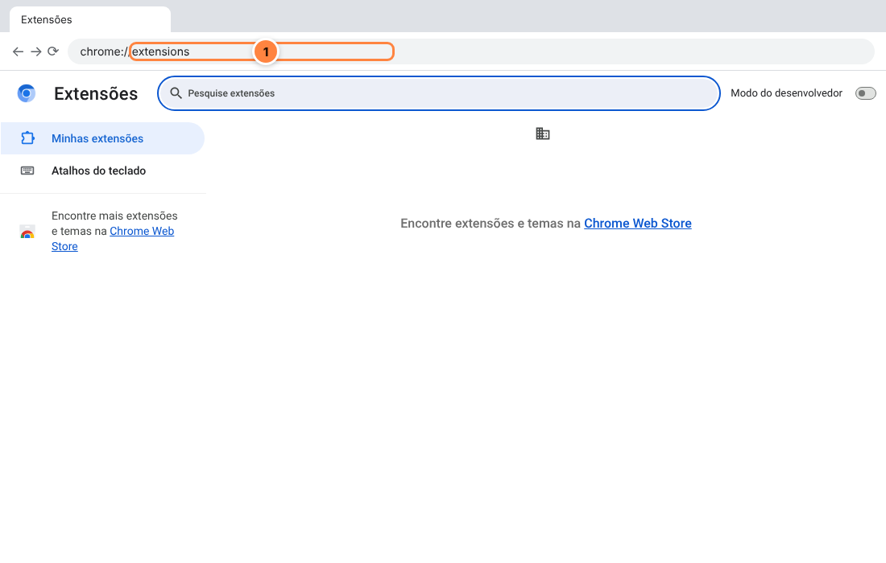

### Passo 2 — Ative o Modo do desenvolvedor
No canto superior direito, ligue a chave **Modo do desenvolvedor ①**.

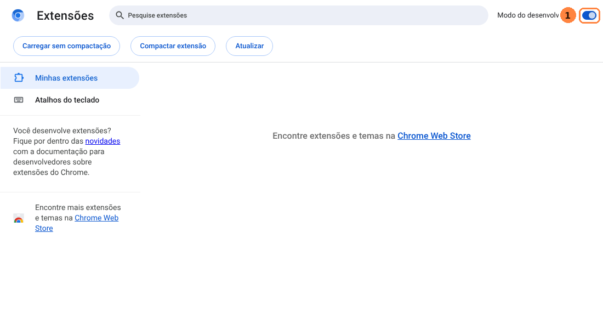

### Passo 3 — Carregue sem compactação
Clique em **Carregar sem compactação ②** e escolha a **pasta** que contém o `manifest.json`.

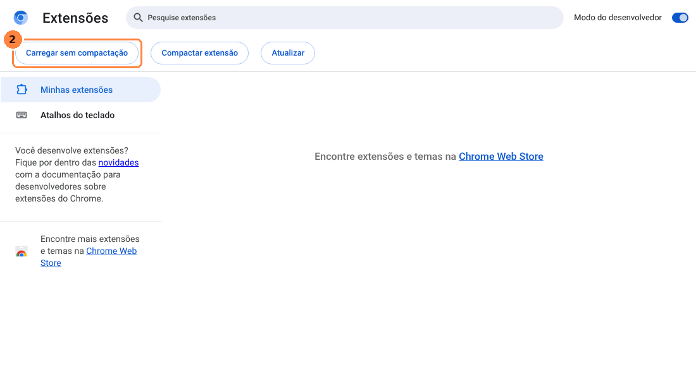

### Passo 4 — Confirme que carregou
O cartão **ARION · Central de Voos ③** aparece na lista, com a chave **④** ligada.

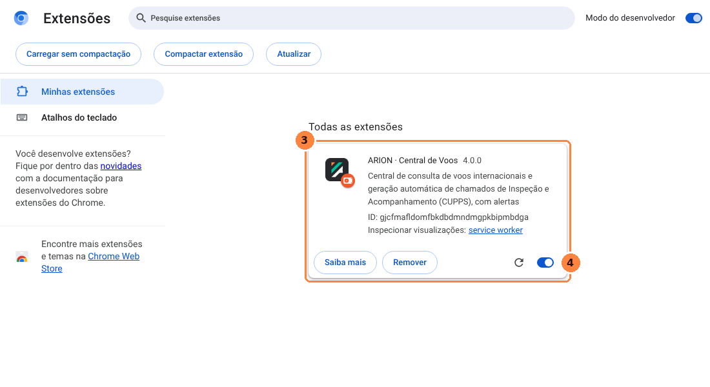

### Passo 5 — Fixe o ícone na barra
Clique no ícone de **peça de quebra-cabeça ①** e no **alfinete ②** ao lado de ARION.

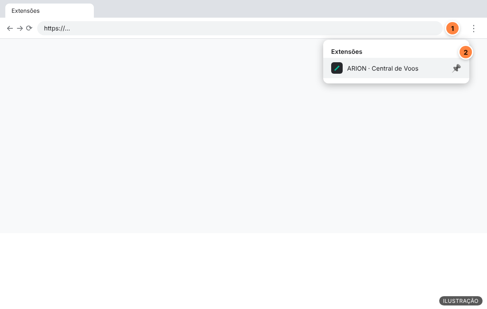

### Passo 6 — Abra o painel lateral
Clique no ícone **①** da ARION. O painel abre ao lado da página **②** e fica aberto enquanto você trabalha.

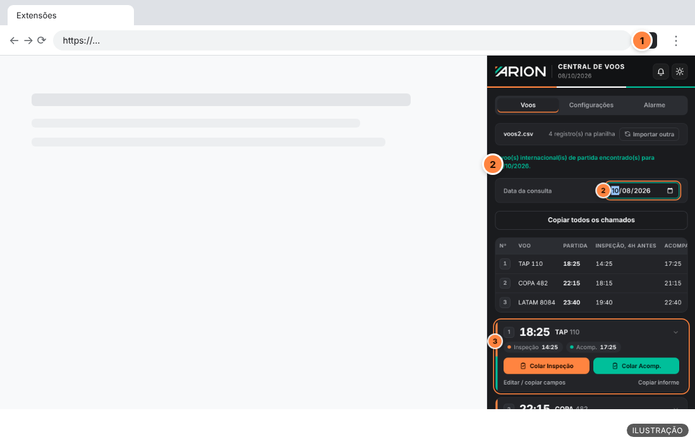

### Passo 7 — Confira a permissão
Em **Detalhes** da extensão, verifique:
1. Acesso ao site `https://*.serviceaide.com/*` **ligado**.
2. **Fixar na barra de ferramentas** (opcional, alternativa ao Passo 5).

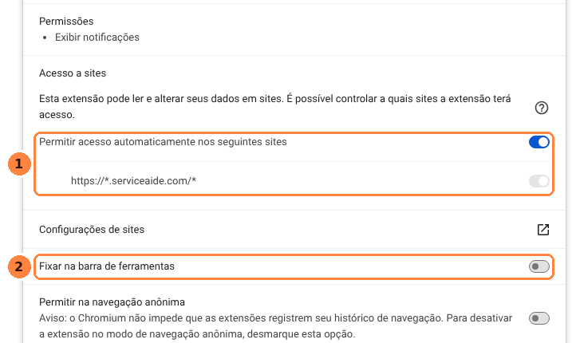

### 🔄 Atualizar para uma versão nova
Substitua os arquivos da pasta pelos novos. Em `chrome://extensions`, clique no ícone de **recarregar ①**.

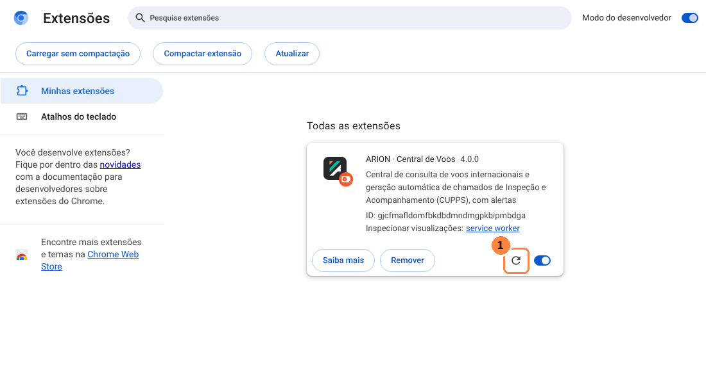

---

## 🦊 Instalar no Firefox

**Antes de começar:** extraia o `.zip` em uma pasta fixa. Use o Firefox 121 ou superior.

### Passo 1 — Abra o depurador
Digite `about:debugging#/runtime/this-firefox` na barra de endereço **①**. Confirme que **Este Firefox ②** está selecionado.

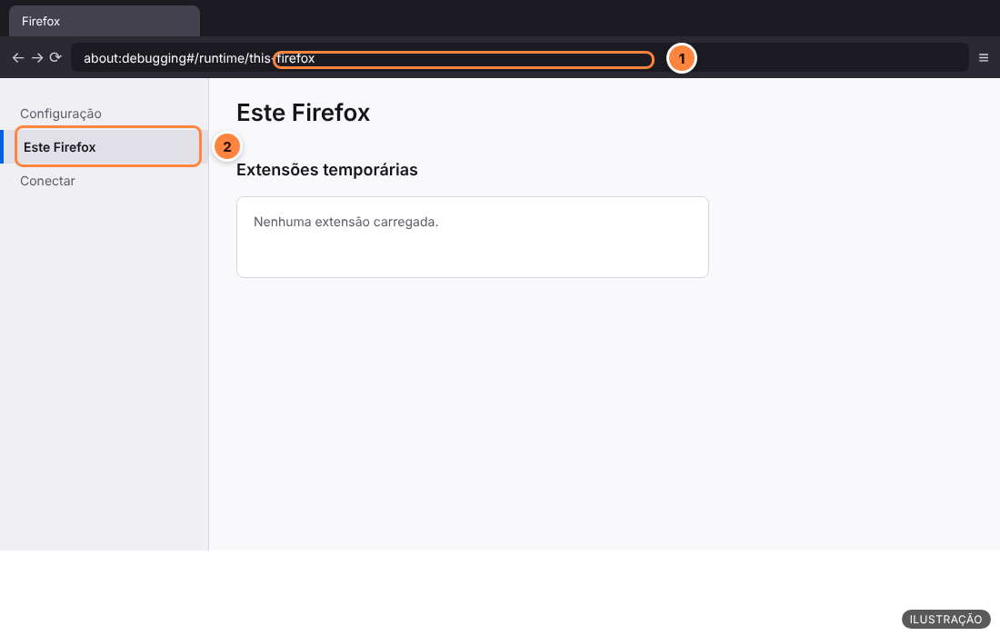

### Passo 2 — Carregue a extensão temporária
Clique em **Carregar extensão temporária… ①** e selecione o arquivo **`manifest.json`** da pasta.

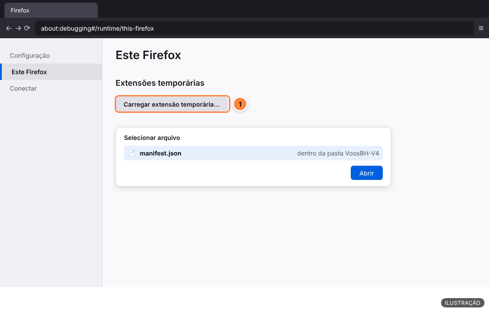

### Passo 3 — Libere o acesso ao ServiceAide
Abra `about:addons` → **ARION · Central de Voos** → aba **Permissões ①**. Ligue **Acessar seus dados em serviceaide.com ②**.

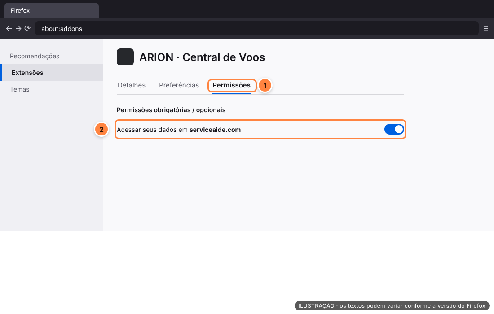

### Passo 4 — Abra a barra lateral
Clique no ícone **①** da ARION na barra de ferramentas. A extensão abre na **barra lateral ②** e **não fecha** ao clicar na página. Clique no ícone de novo para fechar.

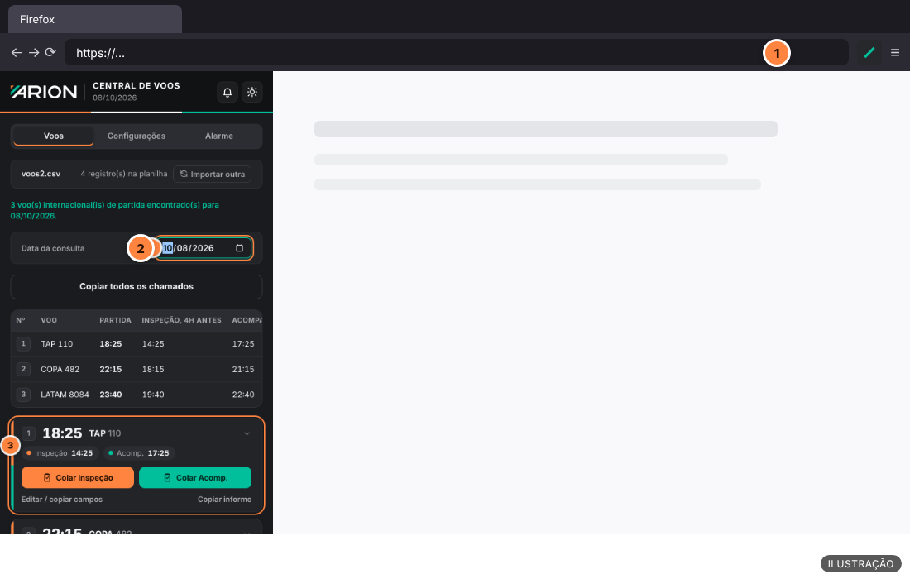

> ⚠️ **Extensão temporária:** o Firefox remove a extensão ao fechar o navegador. É preciso repetir os Passos 1 e 2 a cada abertura (a permissão do Passo 3 costuma ficar salva).
> Para instalar **de forma permanente**, a extensão precisa ser **assinada pela Mozilla** (ou usar o Firefox Developer Edition / Nightly com a assinatura desativada).

---

## 🕹️ Como usar

Deixe o formulário **"Acompanhamento técnico de voo"** aberto em uma aba do ServiceAide.

### 1. Importe a planilha
Na aba **Voos**, arraste o arquivo para a área **①** ou clique para escolher. Aceita `.xlsx`, `.xls` e `.csv`.

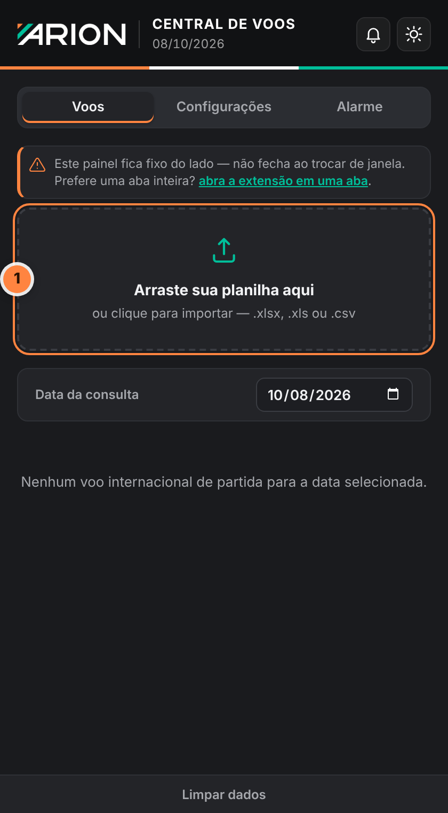

### 2. Escolha a data e confira os voos
Defina a **data ②**. Cada voo aparece em um **card ③** com os horários já calculados.

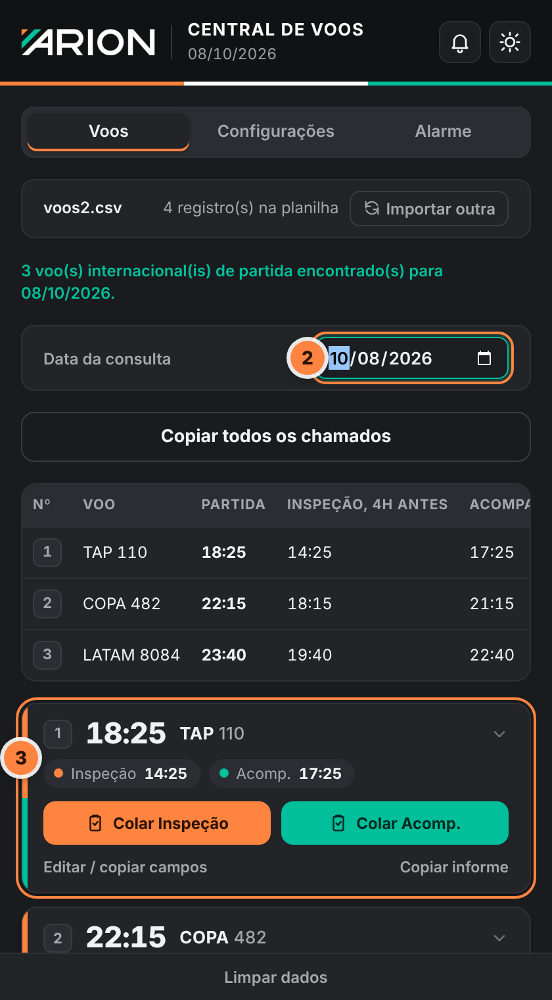

### 3. Cole o chamado
No card, clique em **Colar Inspeção ④** ou **Colar Acomp. ⑤**. Os campos são preenchidos e piscam em verde. Revise e clique em **Salvar** no ServiceAide.

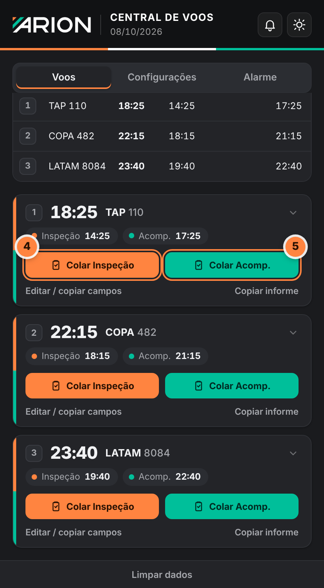

### 4. Ajuste textos, se precisar
Em **Editar / copiar campos**, altere o que for preciso e clique em **Colar no ServiceAide ⑥**. **Copiar ⑦** copia um campo por vez.

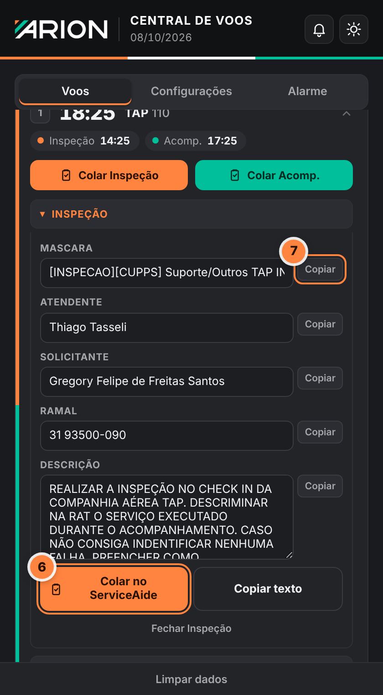

### 5. Copie o informe
Com o chamado **salvo e aberto**, clique em **Copiar informe ⑧**. Cole o texto onde precisar.

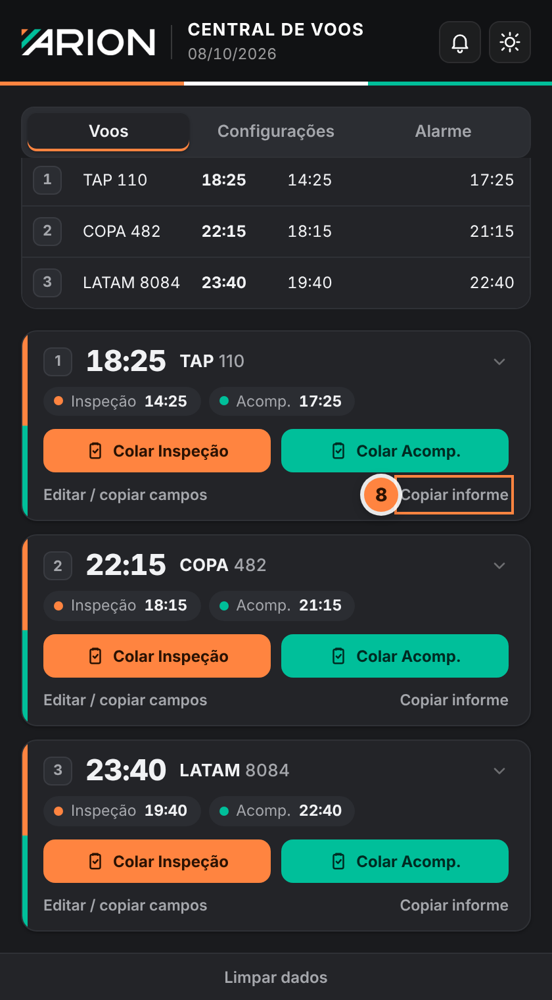

### 6. Controle os alarmes
Aba **Alarme**: ajuste antecedência e horários. O **sino ⑨** silencia tudo; os botões **⑩** silenciam por 30 min, 1 h, 2 h ou até reativar. A notificação continua, só sem som.

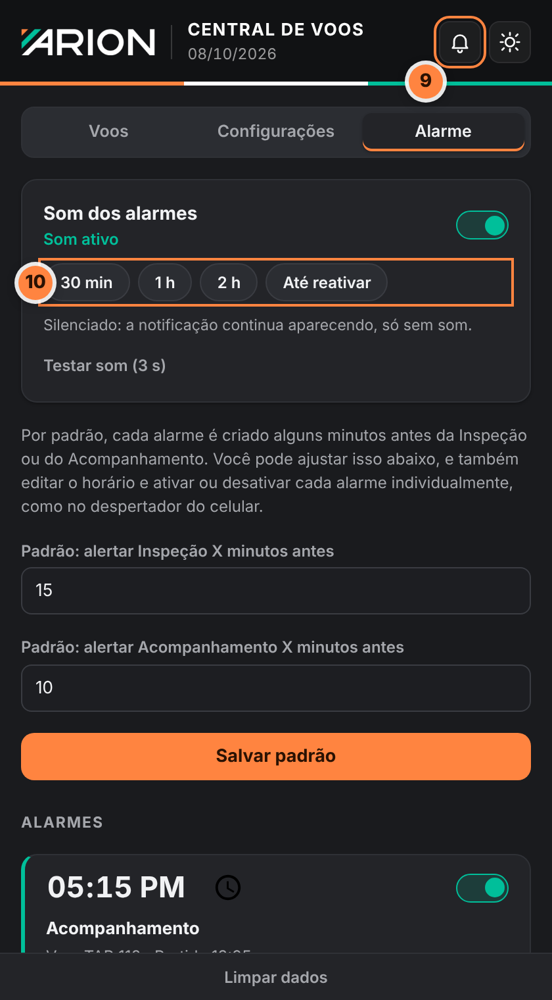

### 7. Ajuste valores fixos
Aba **Configurações**: atendente, telefone, matrícula, busca do **Nome ⑪** e companhias com **departamento próprio ⑫** (as outras vão para Operações).

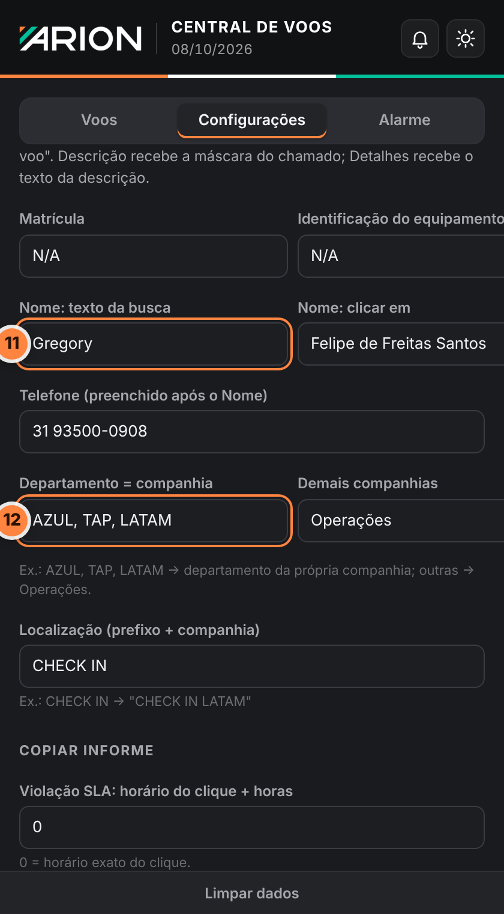

---

## 🛠️ Problemas comuns

| Sintoma | Solução |
|---|---|
| Botão **Colar** não preenche | Abra o formulário do ServiceAide na aba ativa e confira a permissão do site. |
| Extensão sumiu no Firefox | Normal em extensão temporária. Repita os Passos 1 e 2. |
| Extensão sumiu no Chrome | A pasta foi movida ou apagada. Carregue de novo. |
| **Copiar informe** vem vazio | Salve o chamado e deixe-o aberto antes de clicar. |
| Sem som no alarme | Verifique o sino ⑨ e o volume do computador. |
| Nada muda após atualizar | Clique em **recarregar** no `chrome://extensions`. |
| Voos não aparecem | Confira a data e se a planilha tem voos internacionais de partida. |

---

**Grupo ARION** · Uso interno
