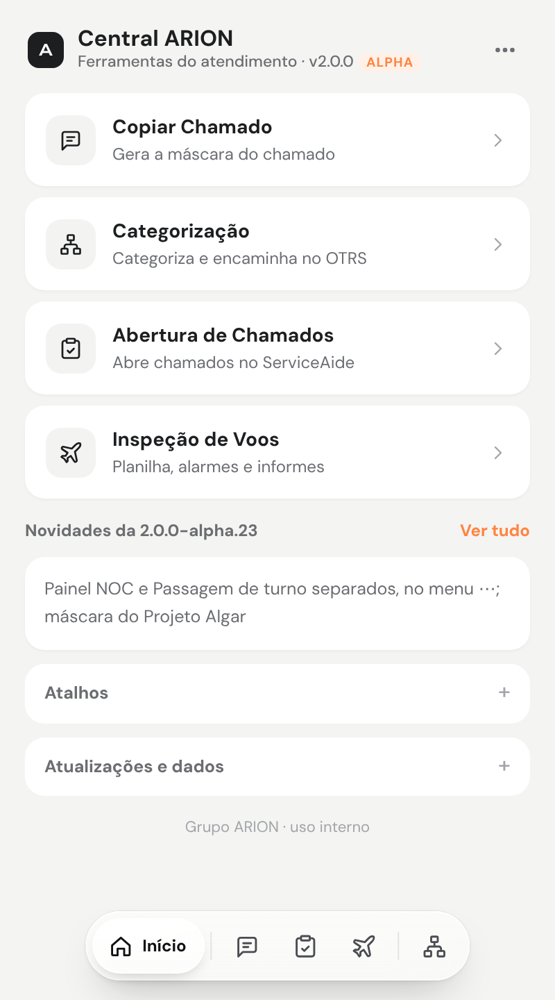
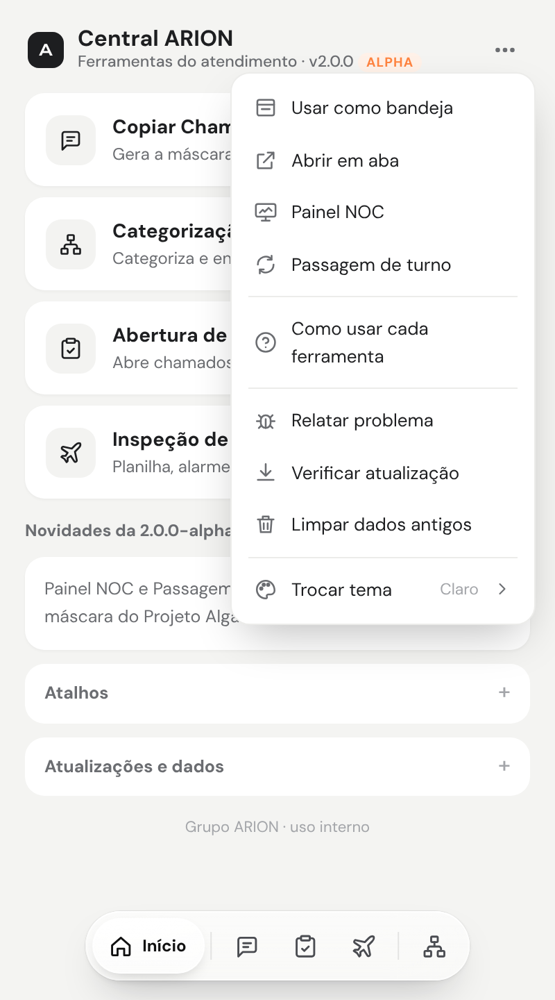

# Início, barra rápida e menu ⋯

> Linguagem: ASD-STE100, adaptada ao português. Frases curtas. Uma ação por passo.

## 1. Abra a Central

1. Clique no ícone **ARION** na barra do navegador.
   Ou pressione **Alt+Shift+A**.

**Resultado:** a Central abre no **Início**.

## 2. Use o Início

O Início mostra:

- os cartões das ferramentas;
- as **Novidades** da versão instalada;
- os **Atalhos**;
- **Atualizações e dados**.

1. Clique num cartão para abrir a ferramenta.

> **NOTA:** um ponto verde no cartão indica a ferramenta do site da aba aberta.

## 3. Use a barra rápida

A barra rápida fica no rodapé: **Início | Copiar · Abrir · Voos | Categorizar**.

1. Clique num ícone para abrir a ferramenta.
2. Passe o mouse no ícone para ver o nome.

| Atalho | Ação |
|---|---|
| **Alt+1** | Início |
| **Alt+2** a **Alt+5** | Copiar, Abrir, Voos, Categorizar |
| **Alt+Shift+A** | Abre a Central |

## 4. Use o menu ⋯

1. No Início, clique em **⋯** (canto superior direito).
2. Clique na opção.

| Opção | Ação |
|---|---|
| **Usar como bandeja / painel** | Muda a forma de exibição da Central. |
| **Abrir em aba** | Abre a Central numa aba do navegador. |
| **Painel NOC** | Abre o Painel NOC. Veja [06-painel-noc.md](06-painel-noc.md). |
| **Passagem de turno** | Abre a Passagem de turno. Veja [08-passagem-de-turno.md](08-passagem-de-turno.md). |
| **Como usar cada ferramenta** | Mostra os passos de cada ferramenta. |
| **Relatar problema** | Monta o relato de um problema. |
| **Verificar atualização** | Procura uma versão nova. |
| **Limpar dados antigos** | Apaga chamados e solicitantes com mais de 7 dias. |
| **Trocar tema** | Muda as cores da Central. É a última opção. |

## 5. Troque o tema

1. Clique em **⋯**.
2. Clique em **Trocar tema**.
3. Passe o mouse nos temas para ver.
4. Clique no tema: Claro, Escuro, Areia, Noite ou Alto contraste.

**Resultado:** a Central usa o tema novo.

## 6. Atualize a Central

A Central procura uma versão nova a cada 6 horas e ao abrir o navegador.

Quando há uma versão nova:

- o ícone ARION mostra o selo **1**;
- aparece uma notificação;
- o Início mostra o aviso com o botão **Baixar**.

1. Clique em **Baixar**.
2. Extraia o zip na mesma pasta da instalação.
3. Abra `chrome://extensions`.
4. No cartão **ARION Central**, clique em recarregar (↻).

> **ATENÇÃO:** não mude a pasta da extensão de lugar. O navegador lê a extensão desta pasta.
