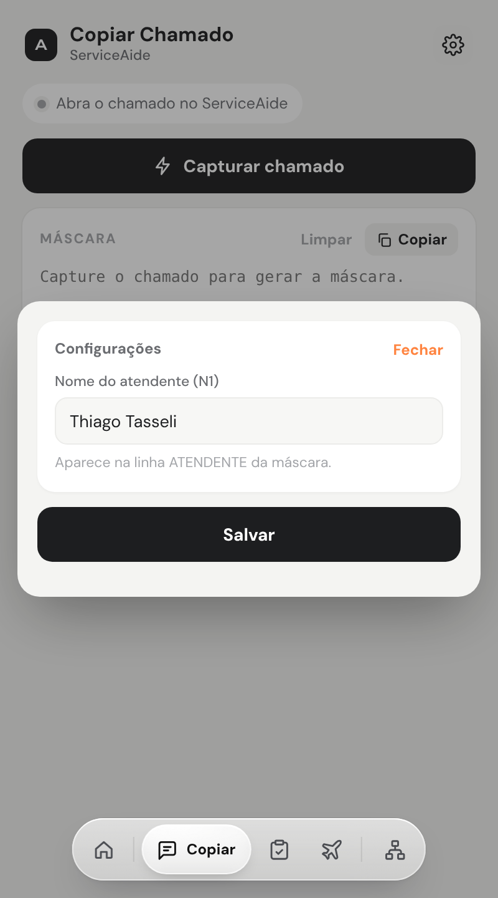
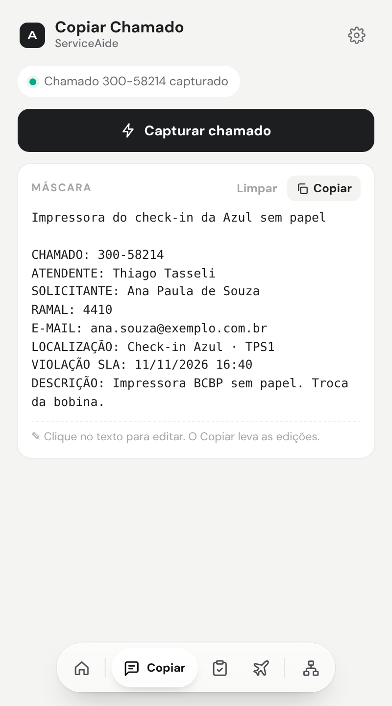

# Copiar Chamado

> Linguagem: ASD-STE100, adaptada ao português. Frases curtas. Uma ação por passo.

**Objetivo:** capturar o chamado aberto no ServiceAide e fazer a máscara pronta para copiar.
**Site:** ServiceAide.

## 1. Configure o seu nome (só na primeira vez)

1. Abra a Central.
2. Clique em **Copiar** na barra rápida.
3. Clique na engrenagem (**Config**).

**Resultado:** a janela de configurações abre.

4. Em **Nome do atendente (N1)**, digite o seu nome.
5. Clique em **Salvar**.

**Resultado:** a janela fecha. O seu nome entra no campo ATENDENTE da máscara.

## 2. Capture o chamado

1. Abra o chamado no ServiceAide.
2. Na Central, clique em **Capturar chamado**.

**Resultado:** a máscara aparece com Título, Chamado, Ramal, Solicitante, E-mail, Local, SLA e Descrição.

> **NOTA:** se um campo está vazio, o campo não existe no chamado. Escreva o valor na máscara.

## 3. Confira e edite a máscara

1. Leia a máscara.
2. Para mudar um texto, clique no texto e escreva.

## 4. Copie a máscara

1. Clique em **Copiar**.

**Resultado:** a máscara vai para a área de transferência. As suas edições vão junto.

2. Cole o texto no destino (Ctrl+V).

## 5. Limpe a tela

1. Clique em **Limpar**.

**Resultado:** a máscara fica vazia.
