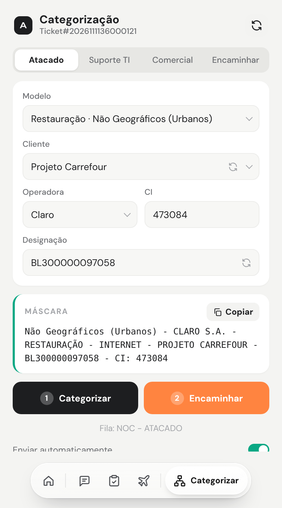
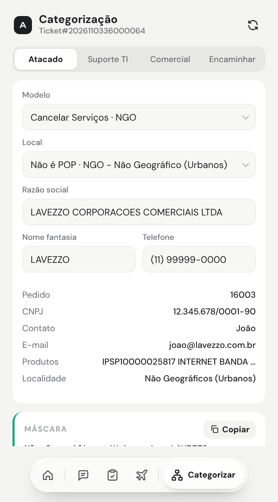
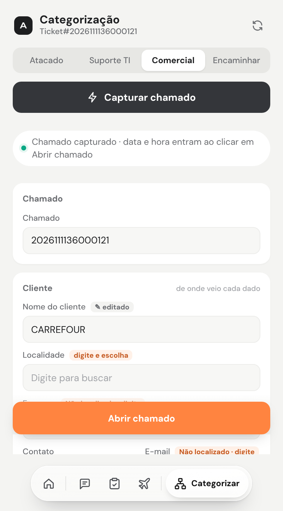
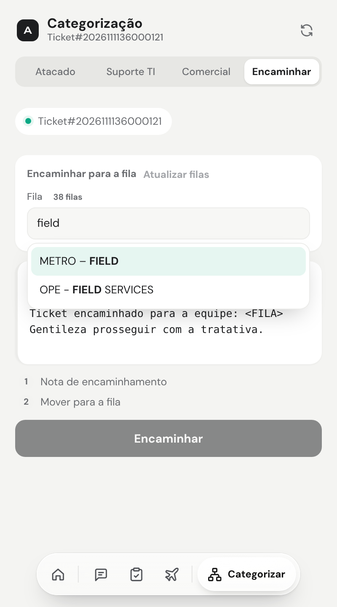
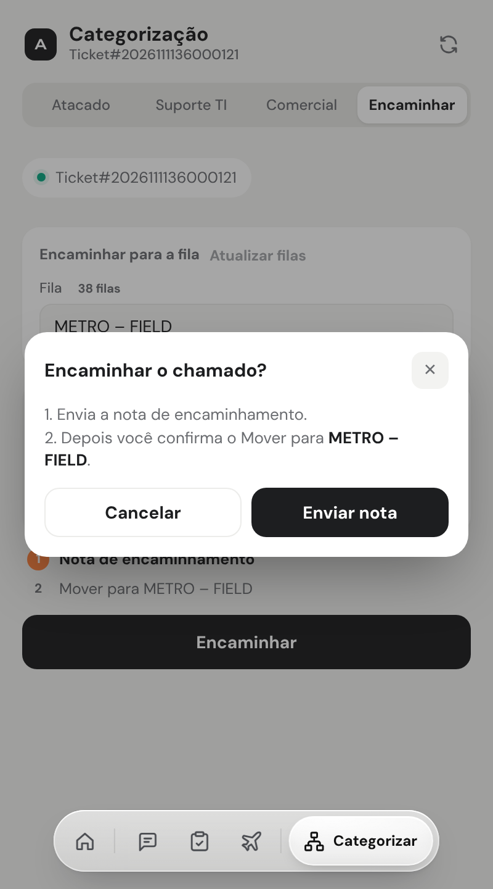
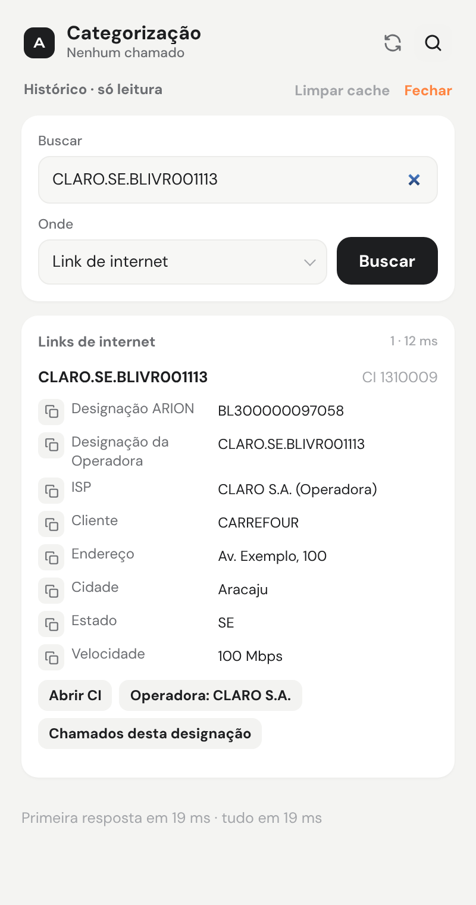
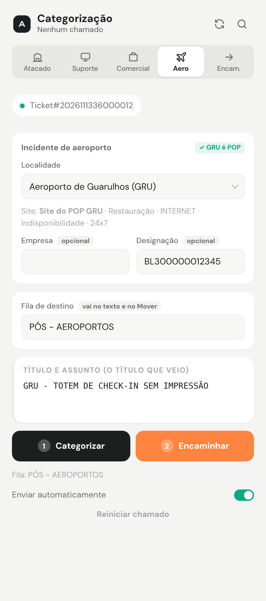

# Categorização (OTRS)

> Linguagem: ASD-STE100, adaptada ao português. Frases curtas. Uma ação por passo.

**Objetivo:** categorizar o chamado no OTRS e encaminhar para a fila certa.
**Site:** OTRS (`suporte.grupoarion.com.br`).

A tela tem 4 abas no topo:

| Aba | Uso |
|---|---|
| **Atacado** | Chamados de operadoras e projetos. Fila NOC - ATACADO e outras. |
| **Suporte TI** | Chamados internos de TI. Fila ENG - SISTEMAS. |
| **Comercial** | Abre um chamado novo a partir de outro e preenche a planilha CSTI. |
| **Encaminhar** | Encaminha o chamado para qualquer fila. |
| **Lupa (Histórico)** | Consulta chamados antigos, links de internet e operadoras. Só leitura. |

## 1. Antes de começar

1. Abra o chamado no OTRS (tela de detalhes do ticket).
2. Abra a Central.
3. Clique em **Categorizar** na barra rápida.

> **NOTA:** se aparecer **Permitir acesso ao OTRS**, clique no botão. Depois clique em **Permitir** na janela do navegador.

---

## 2. Aba Atacado

### 2.1 Confira os dados

A Central lê o título e o corpo do chamado. Ela preenche: **Modelo**, cliente, **Operadora**, designação e **CI**.

1. Clique em **Atacado**.
2. Confira o **Modelo**.
3. Confira a **Operadora**.
4. Confira a designação e o **CI** (ou o identificador do modelo: BRAD, INC, SIGLA, NP).
5. Se um campo está errado, mude o campo.

**Resultado:** a máscara aparece no quadro. Ela muda quando você muda um campo.

### 2.2 Modelos e máscaras

| Modelo | Exemplo de máscara |
|---|---|
| Restauração · Não Geográficos (Urbanos) | `Não Geográficos (Urbanos) - CLARO S.A. - RESTAURAÇÃO - INTERNET - PROJETO CARREFOUR - BL300000097058 - CI: 473084` |
| Restauração · Bradesco | `BRAD - TELEFONICA BRASIL S.A. - RESTAURAÇÃO - INTERNET - BRADESCO - BD0001222 - BRAD: 791` |
| Restauração · Projetos BB, CEF, Correios e FUST | `Projeto FUST - TELEFONICA BRASIL S.A. - RESTAURAÇÃO - INTERNET - PROJETO FUST - VIVO.BA.BLIVR000093 - INC10412506` |
| Restauração · Projeto Algar | `Projeto EILD Algar - SP - RESTAURAÇÃO - INTERNET - PROJETO ALGAR - BL100000104483 - CI: 473084` |
| Reincidência · Bradesco | `[REINCIDENCIA MONITORAMENTO] - TELMEX - BRADESCO - BD500000098988 - BRAD:2950` |
| Cancelamento | `NGO - TELEFONICA BRASIL S.A. - CANCELAMENTO - INTERNET - OP:AN TELECOM - BD0001246 - NP:15576` |
| Cancelar Serviços · NGO | `Não Geográficos (Urbanos) - LAVEZZO CORPORACOES COMERCIAIS LTDA - CANCELAMENTO - INTERNET - Pedido: 16003` |
| Solicitação · Cadastro no CMDB | `Não Geográficos (Urbanos) - NORTH TELECOM - SOLICITAÇÃO - INTERNET - CADASTRO NO CMDB` |
| Solicitação de Tratativa de Qualidade | Título e Assunto = o título que veio. |

> **NOTA:** **Reincidência** e **Cancelamento** só fazem a máscara. Clique em **Copiar** e cole no OTRS.

> **NOTA:** no **Projeto Algar**, escolha o **Estado** (UF). A UF entra na Localidade e na máscara.

### 2.3 Categorize

1. Clique em **Categorizar**.

**Resultado:** a Central preenche a tela de categorização do OTRS: Localidade, cliente, Título, Assunto e texto.

2. Confira os campos no OTRS.

> **NOTA:** se a Localidade ficar errada, clique em **↻ Selecionar a Localidade de novo**.

### 2.4 Encaminhe

1. Clique em **Encaminhar**.

**Resultado:** a Central abre a nota e escreve o texto de encaminhamento.

2. Confira a nota.
3. Clique em **Mover para a fila**.
4. Confirme.

**Resultado:** o chamado vai para a fila do modelo (exemplo: NOC - ATACADO).

> **NOTA:** com **Enviar automaticamente** ligado, a Central envia a nota sozinha. Com o botão desligado, você clica em **Enviar** no OTRS.

### 2.5 Casos especiais

**Arcos Dourados em Confins (CNF)**

1. A Central escolhe **Arcos Dourados**.
2. Se o chamado é de Confins, mude o cliente para **Arcos Dourados - CNF**.
3. Em **Fila do Encaminhar · Confins (POP)**, escolha **OPE - FIELD SERVICES** ou **NOC - SUPORTE AVANÇADO**.
4. Clique em **Categorizar** e depois em **Encaminhar**.

**Cancelar Serviços · NGO** (título `Cancelar Serviços do Pedido: N`)

1. A Central lê do pedido: Razão social, Nome fantasia, Telefone, CNPJ, Contato, E-mail e produtos.
2. Se o local é um POP, a Central avisa e não categoriza.

3. Confira o campo **Local**. Corrija se for preciso.
4. Clique em **Categorizar**.
5. Clique em **Encaminhar**.

**Resultado:** a nota vai e o chamado vai para **NOC - CANCELAMENTOS NGO**.

**Solicitação · Cadastro no CMDB** (palavra `CMDB` no chamado)

1. Confira a **Localidade**: Não Geográficos (Urbanos) ou Não Geográficos (Aeroportos).
2. Confira a **Empresa (Razão social e Nome fantasia)**. Se estiver vazia, digite.
3. Clique em **Categorizar**.
4. Clique em **Encaminhar**.

**Resultado:** o chamado vai para **NOC - ACESSOS E CADASTROS**.

> **ATENÇÃO:** a empresa precisa existir na lista do OTRS. Se não existir, a Central avisa: **Razão social não preenchida**.

**Solicitação de Tratativa de Qualidade**

1. A Central lê cliente, operadora e designação do título.
2. Clique em **Categorizar**.
3. Clique em **Encaminhar**.

**Resultado:** o chamado vai para **NOC - QUALIDADE ATACADO**.

### 2.6 Comece outro chamado

1. Clique em **Reiniciar chamado**.

**Resultado:** a Central limpa os dados do chamado atual.

---

## 3. Aba Suporte TI

1. Clique em **Suporte TI**.
2. Escolha o **Motivo**: Notebook, Celular, Acessos, E-mails, Softwares ou Outras.
3. Clique em **Categorizar**.

**Resultado:** a Central preenche Tipo **Solicitação**, Serviço SGF **SUPORTE TI (Engenharia)**, SLA **Sem SLA**, Site **NGO - NAO GEOGRAFICO** e empresa **Grupo Arion**.

4. Clique em **Encaminhar**.

**Resultado:** o chamado vai para **ENG - SISTEMAS**.

---

## 4. Aba Comercial (teste)

### 4.1 Capture

1. Abra o chamado no OTRS.
2. Clique em **Comercial**.
3. Clique em **Capturar chamado**.

**Resultado:** a Central preenche Chamado, Nome do cliente, Empresa, Contato, E-mail e Descrição. Ao lado de cada campo, ela mostra de onde veio o valor.

4. Se um campo está vazio, digite o valor.
5. Em **Localidade**, digite parte do nome.
6. Clique na localidade certa da lista.

### 4.2 Abra o chamado novo

1. Clique em **Abrir chamado** (botão fixo no rodapé).

**Resultado:** a Central grava a Data e a Hora do clique. Ela abre o chamado novo no OTRS e preenche os campos.

2. Confira os campos no OTRS.
3. Clique em **Enviar** no OTRS.

> **NOTA:** os valores fixos do chamado novo (Tipo, Serviço SGF, Serviço, SLA, Site, Assunto) ficam em **Campos do chamado novo (OTRS)**.

### 4.3 Preencha a planilha CSTI

1. No cartão **Planilha CSTI**, clique no ícone de copiar do campo.
2. Cole na coluna certa da planilha.
3. Faça o mesmo para CHAMADO, NOME DO CLIENTE, EMPRESA, DATA e HORA.

> **NOTA:** **Copiar linha** copia as 5 colunas de uma vez. Cole na coluna A da linha vazia.

4. Para começar outro, clique em **Limpar captura**.

---

## 5. Aba Encaminhar (qualquer fila)

1. Abra o chamado no OTRS (tela de detalhes).
2. Clique em **Encaminhar**.
3. Em **Fila**, digite parte do nome.
4. Clique na fila certa da lista.

> **NOTA:** a lista tem as 38 filas do OTRS. Hífen e travessão contam como iguais. **Atualizar filas** lê a lista outra vez no chamado.

5. Confira a **Nota de encaminhamento**. Edite se for preciso.
6. Clique em **Encaminhar**.
7. Clique em **Enviar nota** na janela.

**Resultado:** a Central envia a nota. O botão muda para **Mover para** e o nome da fila.

8. Clique em **Mover para …**.
9. Clique em **Mover** na janela.

**Resultado:** o chamado vai para a fila.

> **ATENÇÃO:** o Mover não tem desfazer. Confira a fila antes de confirmar.

---

## 6. Histórico (lupa)

**Objetivo:** consultar e copiar dados do OTRS para preencher o chamado. Só leitura.

1. Clique na lupa no topo da Categorização (ao lado do ↻).

**Resultado:** a busca do Histórico abre no lugar das abas.

2. Em **Buscar**, digite a designação, o número do chamado, a operadora ou uma palavra.
3. Em **Onde**, escolha:
   - **Chamados antigos**;
   - **Link de internet**;
   - **Operadora**.
4. Pressione **Enter**.
   Ou clique em **Buscar**.

**Resultado:** os resultados aparecem em cartões.

5. Para copiar um valor, clique no ícone de copiar ao lado do campo.

**Resultado:** o valor vai para a área de transferência. Aparece **Copiado**.

6. Para ir à operadora do link, clique em **Operadora: …**.
7. Para ver os chamados da designação, clique em **Chamados desta designação**.
8. Para fechar, clique em **Fechar** ou pressione **Esc**.

> **NOTA:** chamados: primeiro 30 dias, depois 12 meses. **Histórico completo** busca sem limite de data (cerca de 15 s).

> **NOTA:** a Central guarda as buscas no navegador: chamados por 30 min, links e operadoras por 24 h. **Limpar cache** apaga.

> **ATENÇÃO:** senha e PPPoE nunca aparecem e nunca são salvos.

## 7. Aba Aeroportos

**Objetivo:** categorizar um incidente de aeroporto e encaminhar para a fila que você escolher.

1. Clique na aba **Aero**.

**Resultado:** a Central lê o título e acha o aeroporto.

   - Se o aeroporto é POP (GRU, GIG, BSB, CNF, VCP, FLN, MEA, VIX, POA, FOR, CGH, CWB, CGB, NAT), a Localidade e o Site são do POP. Aparece **✓ GRU é POP**.
   - Se não é POP, a Localidade é **Não Geográficos (Aeroportos)** e o Site é **NGO - NAO GEOGRAFICO**. Aparece **Sem POP: Não Geográfico**.

2. Confira a **Localidade**. Se estiver errada, escolha outra na lista.
3. Empresa e Designação são opcionais. A designação (BL…) vem do chamado, se existir.
4. Em **Fila de destino**, digite e escolha a fila.
5. Confira o **Título e Assunto**. É o título que veio no chamado.
6. Clique em **1 Categorizar**.

**Resultado:** a Central preenche os campos do Atacado: Restauração · INTERNET · Indisponibilidade · Internet · 24 Horas 24x7. O texto informa a fila escolhida.

7. Clique em **2 Encaminhar**.

**Resultado:** a Central envia a nota de encaminhamento. O botão muda para **Mover para a fila**.

8. Clique em **Mover para a fila**. Confirme.

**Resultado:** o chamado vai para a fila. O botão mostra **✓ Encaminhado**.

> **Atenção:** o Mover não tem desfazer.

- **Enviar automaticamente** é o mesmo do Atacado.
- **Reiniciar chamado** lê o chamado de novo e limpa a fila.
