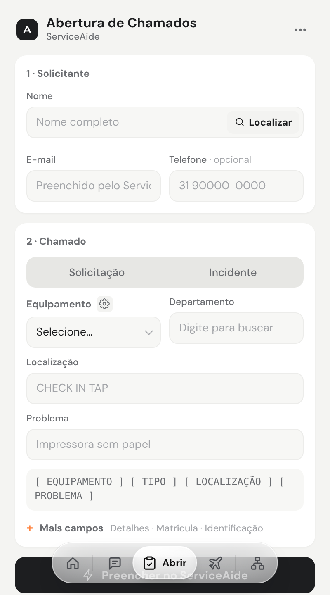
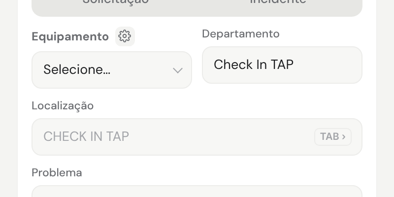
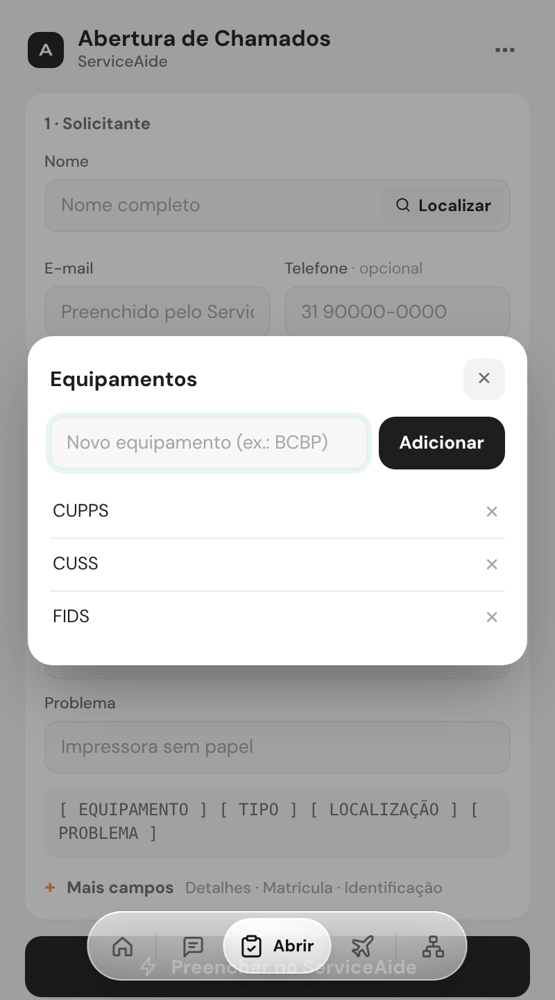

# Abertura de Chamados

> Linguagem: ASD-STE100, adaptada ao português. Frases curtas. Uma ação por passo.

**Objetivo:** preencher o formulário do chamado no ServiceAide e fazer o texto do chamado.
**Site:** ServiceAide.

## 1. Abra o formulário

1. No ServiceAide, abra o formulário de chamado novo.
2. Abra a Central.
3. Clique em **Abrir** na barra rápida.

## 2. Preencha o solicitante (1 · Solicitante)

1. Em **Nome**, digite o nome do solicitante.
2. Clique em **Localizar**.

**Resultado:** a Central procura o solicitante no ServiceAide e preenche os dados encontrados.

3. Se for preciso, digite o **Telefone**. Este campo é opcional.

## 3. Preencha o chamado (2 · Chamado)

1. Clique em **Solicitação** ou **Incidente**.
2. Escolha o **Equipamento**.
3. Escolha o **Departamento**.
4. Escolha ou digite a **Localização**.
   Depois do Departamento, a Localização mostra o mesmo texto em cinza.
   Para aceitar, pressione **TAB** ou **→**. Continue a escrever depois do texto.

   
5. Escreva o **Problema**.
6. Para Detalhes, Matrícula e Identificação, clique em **Mais campos**.

## 4. Preencha no ServiceAide

1. Clique em **Preencher no ServiceAide**.

**Resultado:** a Central escreve os campos no formulário do ServiceAide.

2. Confira os campos no ServiceAide.
3. Clique em **Salvar** no ServiceAide.

> **ATENÇÃO:** a Central não salva o chamado. Você salva.

## 5. Copie o texto do chamado

1. Com o chamado salvo e aberto, clique em **Copiar**.

**Resultado:** a Central captura o chamado e copia o texto no modelo da máscara.

2. Cole o texto no destino (Ctrl+V).

## 6. Mude a lista de equipamentos

1. Clique na engrenagem ao lado de **Equipamento**.

**Resultado:** a janela **Equipamentos** abre.

2. Para adicionar: digite o nome e clique em **Adicionar**.
3. Para remover: clique em **✕** ao lado do nome.
4. Feche a janela.

## 7. Limpe a tela

1. Clique em **Limpar campos**.

**Resultado:** todos os campos ficam vazios.
