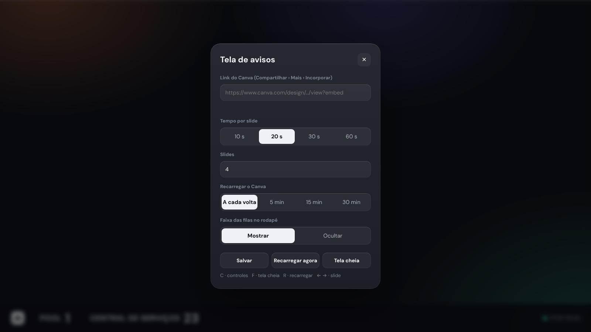
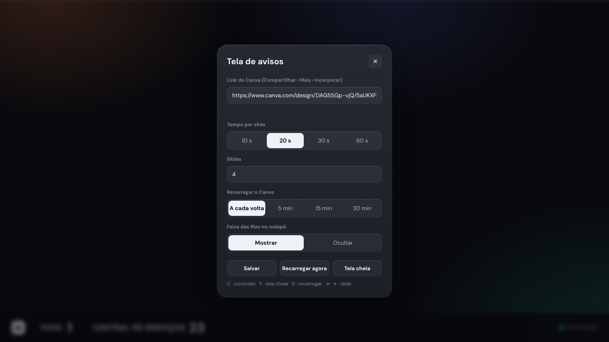
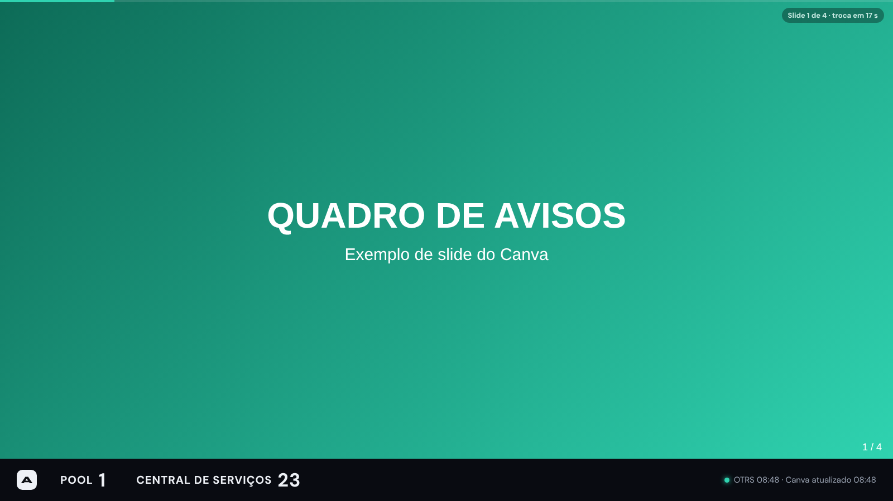

# Tela de avisos (Canva)

> Linguagem: ASD-STE100, adaptada ao português. Frases curtas. Uma ação por passo.

**Objetivo:** mostrar os avisos do Canva na TV do meio e passar os slides sem ajuda.
**Site:** Canva (só leitura).
**Onde abrir:** Início › ⋯ › **Painel NOC** › **Tela de avisos (Canva)**.

## Termos

| Termo | Significado |
|---|---|
| **Link de incorporação** | O link do Canva que termina em `/view?embed`. |
| **Slide** | Uma página visível do design no Canva. Página oculta não conta. |
| **Volta** | Todos os slides passam uma vez. |
| **Faixa das filas** | A barra no rodapé com o Pool e a Central de Serviços. |

## 1. Pegue o link no Canva

1. Abra o design dos avisos no Canva.
2. Clique em **Compartilhar**.
3. Em **Acesso**, escolha **Qualquer pessoa com o link**.
4. Clique em **Mais (…)**.
5. Clique em **Incorporar**.
6. Copie o **link de incorporação**.

> **NOTA:** você pode copiar o código `<iframe …>` inteiro. A Central tira o link do código.

## 2. Abra a Tela de avisos (no PC da TV)

1. Abra a Central.
2. Clique em **⋯** e depois em **Painel NOC**.
3. Clique em **Tela de avisos (Canva)**.

**Resultado:** a Tela de avisos abre numa janela nova.

4. Leve a janela para a TV do meio.
5. Pressione **F**.

**Resultado:** a Tela de avisos fica em tela cheia.

## 3. Configure (só na primeira vez)

1. Pressione **C**.

**Resultado:** a janela **Tela de avisos** abre.

2. Em **Link do Canva**, cole o link de incorporação.
3. Em **Tempo por slide**, escolha 10 s, 20 s, 30 s ou 60 s.
4. Em **Slides**, digite a quantidade de slides visíveis.
   Se aparecer "N lidos do Canva" ao lado de **Slides**, a Central conta os slides sozinha.
5. Em **Recarregar o Canva**, escolha **A cada volta**, **5 min**, **15 min** ou **30 min**.
6. Em **Faixa das filas no rodapé**, escolha **Mostrar** ou **Ocultar**.
7. Clique em **Salvar**.

**Resultado:** o 1º slide aparece. A Central passa os slides sozinha.

## 4. Use as teclas

| Tecla | Ação |
|---|---|
| **C** | Abre e fecha os controles. |
| **F** | Tela cheia (liga e desliga). |
| **R** | Recarrega o Canva agora. |
| **→** | Próximo slide. |
| **←** | Slide anterior. |
| **Esc** | Fecha os controles. |

## 5. Mude os avisos

1. Edite o design no Canva, **em outro computador**.

**Resultado:** a Tela de avisos mostra a mudança no próximo recarregamento.

> **ATENÇÃO:** não entre no Canva pelo navegador do PC da TV. Com o Canva logado, o Canva recusa abrir dentro da Central.

> **NOTA:** se você criar ou ocultar um slide e não aparecer "lidos do Canva", mude o campo **Slides** (passo 3.4).

## 6. Resolva problemas

| Problema | Ação |
|---|---|
| "A conexão com www.canva.com foi recusada" | Saia do Canva neste navegador. Apague os dados do site canva.com (`chrome://settings/content/all`). Abra a Tela de avisos outra vez. |
| Tela de login do Canva | O design não está público. Faça o passo 1.3. |
| "Esse link não é do Canva" | Use o link de **Incorporar**, não o link de editar. |
| O slide não muda | Confira o campo **Slides** e o **Tempo por slide**. |
| A barra do Canva (‹ 1/4 ›, zoom, ⋯) aparece | É do próprio Canva. A Central ainda não esconde esta barra. |
| "carregando o próximo…" demora | O Canva está lento. A Central espera o slide ficar pronto. |
