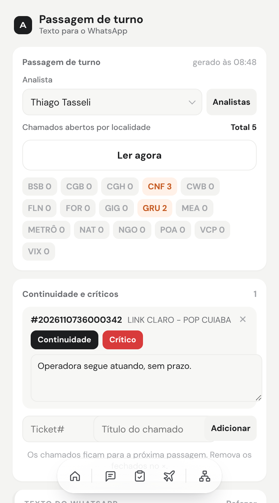
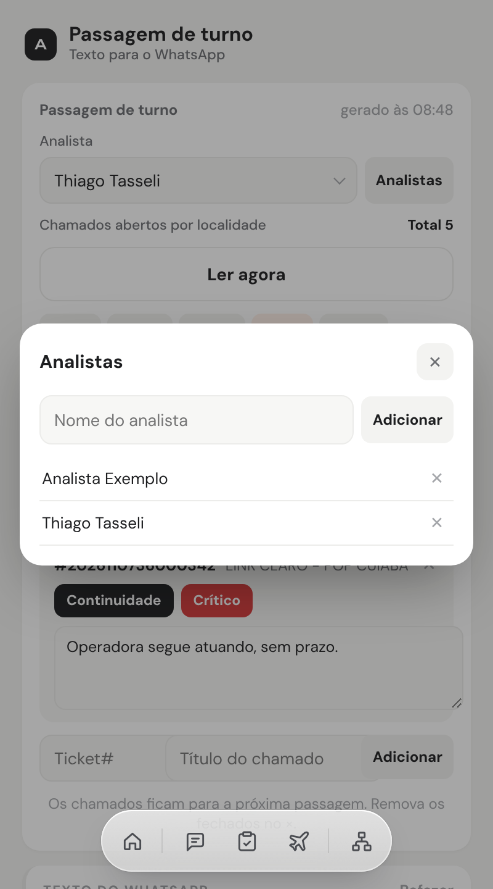
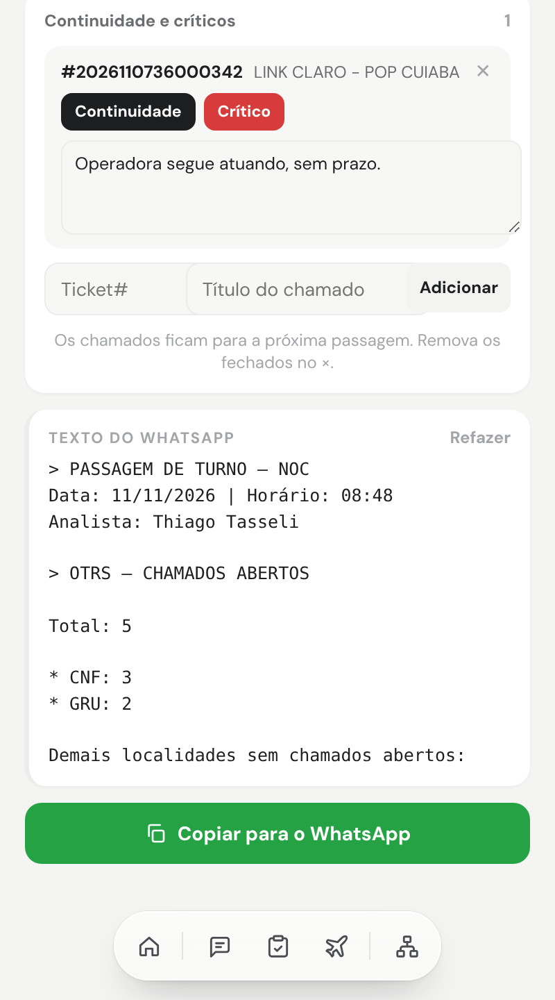

# Passagem de turno

> Linguagem: ASD-STE100, adaptada ao português. Frases curtas. Uma ação por passo.

**Objetivo:** fazer o texto da passagem de turno para o WhatsApp.
**Site:** OTRS · Indicadores › KPI (grupo PASSAGEM DE TURNO).
**Onde abrir:** Início › ⋯ › **Passagem de turno**.

## Termos

| Termo | Significado |
|---|---|
| **Localidade** | Uma das 16 siglas do grupo PASSAGEM DE TURNO: BSB, CGB, CGH, CNF, CWB, FLN, FOR, GIG, GRU, MEA, METRÔ, NAT, NGO, POA, VCP, VIX. |
| **Continuidade** | Chamado que o próximo turno precisa continuar. |
| **Crítico** | Incidente crítico em aberto. |
| **Status** | A situação do chamado, escrita por você. |

## 1. Abra a Passagem de turno

1. Abra a Central.
2. Clique em **⋯**.
3. Clique em **Passagem de turno**.



## 2. Cadastre os analistas (só na primeira vez)

1. Clique em **Analistas**.

**Resultado:** a janela **Analistas** abre.



2. Digite o nome do analista.
3. Clique em **Adicionar**.
4. Faça os passos 2 e 3 para cada analista.
5. Para remover um analista, clique em **✕** ao lado do nome.
6. Feche a janela.

## 3. Escolha o analista

1. Em **Analista**, escolha o seu nome.

**Resultado:** a Central lembra o último analista escolhido.

## 4. Traga os números

1. Confira se o OTRS está logado neste navegador.
2. Clique em **Ler agora**.

**Resultado:** a Central lê o grupo PASSAGEM DE TURNO do OTRS. As localidades e o **Total** aparecem.

> **NOTA:** só as 16 localidades entram no total. As outras são de outro setor.

## 5. Adicione os chamados

1. Em **Ticket#**, digite o número do chamado.
2. Em **Título do chamado**, digite o título.
3. Clique em **Adicionar**.

**Resultado:** o chamado aparece na lista com **Continuidade** ligado.

4. Para um incidente crítico, clique em **Crítico**.
5. Para tirar da continuidade, clique em **Continuidade**.
6. No campo de status, escreva a situação do chamado.

> **NOTA:** os chamados ficam salvos para a próxima passagem. Remova os fechados no **✕**.

## 6. Confira o texto

1. Leia o **Texto do WhatsApp**.
2. Se for preciso, edite o texto.



> **NOTA:** **Refazer** desfaz as suas edições e faz o texto outra vez.

## 7. Copie para o WhatsApp

1. Clique em **Copiar para o WhatsApp**.

**Resultado:** o texto vai para a área de transferência, com a data e a hora do clique.

2. Abra o grupo no WhatsApp.
3. Cole o texto (Ctrl+V).
4. Envie.

## Modelo do texto

```
> PASSAGEM DE TURNO – NOC
Data: 11/11/2026 | Horário: 07:00
Analista: Nome do analista

> OTRS – CHAMADOS ABERTOS

Total: 5

* GRU: 2
* CNF: 3

Demais localidades sem chamados abertos:
BSB, CGB, CGH, CWB, FLN, FOR, GIG, MEA, METRÔ, NAT, NGO, POA, VCP e VIX

> CHAMADOS PARA CONTINUIDADE

Ticket#2026110736000342 — LINK CLARO - POP CUIABA

> INCIDENTE CRÍTICO EM ABERTO

Nenhum

>STATUS:

LINK CLARO - POP CUIABA: Operadora segue atuando, sem prazo.
```
